# Análise Exploratória de Dados nas Ciências da Saúde

[▶ Abrir apresentação](slides/aula04_aed/index.html){.deck-btn target="_blank"}

Imagine que você está diante de um baú misterioso, trancado por enigmas e segredos. Dentro dele, um universo de informações à espera de ser descoberto. A chave para abrir este baú é a **Análise Exploratória de Dados (AED)**.

A metáfora é boa, mas convém trocá-la por uma cena concreta: você acaba de receber a planilha de uma clínica-escola com 240 pacientes, seis colunas e nenhuma legenda. Antes de perguntar "o tratamento funcionou?", é preciso perguntar **o que esses números são capazes de dizer**. A AED é essa etapa — e ela ocupa, na prática real, mais tempo do que o teste estatístico que vem depois.

Neste capítulo você vai aprender a fazer as quatro perguntas que abrem qualquer conjunto de dados, a escolher a medida de resumo certa para cada tipo de variável, a reconhecer um gráfico que informa e um gráfico que engana, e a montar uma tabela que um revisor aceite sem pedir correção.

## A pergunta que este capítulo responde

Sua planilha tem, entre outras colunas, idade, sexo, dor antes e depois da fisioterapia (escala 0–10), número de sessões e tempo de internação. A pergunta do estudo é se a fisioterapia reduz a dor. Antes de qualquer teste, quatro perguntas precisam de resposta:

1. **Onde está o centro?** — qual é o valor típico de cada variável;
2. **Quanto os dados se espalham?** — dois grupos com a mesma média podem ser completamente diferentes;
3. **Qual é a forma da distribuição e existem valores improváveis?** — um único erro de digitação pode inverter uma conclusão;
4. **Como as variáveis se relacionam?** — a dor cai junto com o número de sessões, ou não?

As respostas decidem três coisas: a **medida** que você vai relatar, o **gráfico** que vai desenhar e o **teste** que fará sentido usar depois.

::: {.keybox}
**A regra do capítulo:** primeiro olhe, depois conte. Nenhum teste estatístico conserta dados que você não examinou — ele apenas disfarça o problema com um valor de *p*.
:::

## Vocabulário mínimo

| Termo | O que é | Exemplo | Símbolo |
|:--|:--|:--|:--|
| **Unidade de análise** | O "tijolo" medido | O paciente (ou o dente, ou o sítio periodontal) | — |
| **Variável** | O que foi medido em cada unidade | Hemoglobina, dor (EVA), índice CPO-D | — |
| **Observação** | Uma linha da planilha | Um paciente | — |
| **Distribuição** | O conjunto dos valores de uma variável | As 240 hemoglobinas | — |
| **Medida de resumo** | Um número que condensa a distribuição | Média, mediana, desvio padrão | $\bar{x}$, $s$ |
| **Outlier** | Valor muito distante do resto | Hemoglobina de 2 g/dL | — |

::: {.callout-warning}
## A unidade de análise muda a conta

Em Odontologia é comum medir **dentes** ou **sítios** por paciente. Cem dentes de 25 pacientes não são cem observações independentes: os dentes de uma mesma boca se parecem entre si por compartilhar a mesma saliva, a mesma dieta e o mesmo biofilme. Tratar cada dente como um paciente infla o *n*, estreita o intervalo de confiança e produz um valor de *p* que o estudo não ganhou.

É a mesma armadilha da dependência discutida no capítulo 3: **o número de linhas da planilha não é o número de informações independentes.**
:::

## Por que explorar antes de testar

Quatro razões, todas com consequência prática:

::: {.cards .cols-2}
::: {.card}
**Encontrar o impossível**

Frequência cardíaca de 800 bpm, idade de 250 anos, glicemia negativa, pressão de 1.200 mmHg. Quase sempre é erro de digitação ou troca de unidade — e corrigir isso na fonte é barato.
:::

::: {.card}
**Escolher o teste certo**

Testes paramétricos supõem distribuição aproximadamente simétrica e sem outliers extremos. Se essa suposição falha, o teste escolhido responde a outra pergunta.
:::

::: {.card}
**Descobrir que a média esconde histórias**

Dois grupos podem ter a mesma média e significados clínicos opostos. A média é um resumo, e todo resumo perde informação.
:::

::: {.card}
**Gerar hipóteses**

Um padrão inesperado na exploração — "os pacientes com mais sessões são justamente os que menos melhoram" — pode valer um artigo, ou revelar um confundidor.
:::
:::

### A média esconde histórias: um exemplo de dor

Dois analgésicos foram testados em pacientes com dor lombar. A tabela mostra a redução da dor na EVA, em cada paciente:

| Paciente | Analgésico A | Analgésico B |
|--:|--:|--:|
| 1 | 3,0 | 6,0 |
| 2 | 3,2 | 6,2 |
| 3 | 3,4 | 6,0 |
| 4 | 3,0 | 6,2 |
| 5 | 3,4 | 0,2 |
| 6 | 3,2 | 0,4 |
| 7 | 3,0 | 0,2 |
| 8 | 3,4 | 0,4 |
| **Média** | **3,2** | **3,2** |
| **Desvio padrão** | **0,19** | **3,10** |

As duas médias são idênticas: 3,2 pontos. E as conclusões clínicas são opostas.

No grupo A, **todos** melhoraram algo entre 3,0 e 3,4 pontos — um efeito modesto e previsível. No grupo B, metade melhorou 6 pontos (quase desapareceu a dor) e metade praticamente não melhorou. Se o artigo relatasse somente "redução média de 3,2 pontos", o leitor não saberia que B é um medicamento que funciona muito bem em alguns pacientes e quase nada em outros.

É por isso que média e desvio padrão andam juntos, e é por isso que o gráfico importa: a média é uma frase; o gráfico é a história.

<p class="small">Dados simulados para o exemplo. Todos os números desta seção podem ser conferidos no R, na seção "No R, passo a passo".</p>

## O centro: média, mediana e moda

Há três respostas possíveis para "onde fica o valor típico", e elas não são intercambiáveis.

### A média aritmética, termo a termo

A média aritmética é a soma de todos os valores dividida pelo número de valores:

$$\bar{x} = \frac{x_1 + x_2 + \cdots + x_n}{n} = \frac{1}{n}\sum_{i=1}^{n} x_i$$

Cada pedaço da fórmula tem um papel:

| Símbolo | Como se lê | O que significa na planilha |
|:--|:--|:--|
| $x_i$ | "x índice i" | o valor de cada paciente, na ordem em que aparece |
| $n$ | tamanho da amostra | quantos pacientes entram na conta |
| $\sum_{i=1}^{n}$ | somatório, de 1 até $n$ | some todos os valores, do primeiro ao último |
| $\bar{x}$ | "x barra" | o resultado: a média da amostra |

Com as seis glicemias que servem de fio condutor neste capítulo (90, 95, 100, 105, 110, 800):

$$\bar{x} = \frac{90 + 95 + 100 + 105 + 110 + 800}{6} = \frac{1\,300}{6} = 216{,}7\ \text{mg/dL}$$

A conta é trivial. O que importa são **três propriedades** que explicam por que a média se comporta como se comporta:

1. **A soma dos desvios é sempre zero.** Se você subtrair a média de cada valor e somar os resultados, chega a zero. A média é o ponto de equilíbrio: o que está acima compensa exatamente o que está abaixo.
2. **A média é o número que minimiza a soma dos quadrados dos desvios.** Entre todos os valores possíveis, é a média que torna $\sum (x_i - c)^2$ o menor possível. Guarde isso: é a razão matemática pela qual a variância usa a média como referência — e a razão histórica pela qual o método dos mínimos quadrados venceu.
3. **Todo valor entra com o mesmo peso.** O 800 entra na soma exatamente como o 90. A média não sabe que 800 é implausível; ela só soma.

::: {.callout-note}
## E a "média ponderada"? Não é a mesma coisa?

É parecida, mas não é a mesma. Na média aritmética simples, cada observação vale 1. Na ponderada, cada observação vale um peso $w_i$:

$$\bar{x}_w = \frac{\sum w_i x_i}{\sum w_i}$$

Quando todos os pesos são iguais, a fórmula ponderada **se reduz** à aritmética. Ou seja: a média aritmética é um caso particular da ponderada, e é a escolha certa quando não há motivo para dar peso diferente a nenhum paciente. Se há motivo — e ele precisa ser declarado —, use a ponderada.
:::

### Por que a média aritmética, e não a ponderada, a geométrica ou a harmônica?

Porque "média" não é uma conta: é uma **decisão sobre o que se soma**. Existem quatro médias clássicas, e cada uma responde a uma pergunta diferente. Escolher a errada não produz um arredondamento impreciso — produz um **erro sistemático**, que cresce com a dispersão dos dados.

| Média | Fórmula | Pergunta que responde | Exemplo em ciências da vida |
|:--|:--|:--|:--|
| **Aritmética** | $\frac{1}{n}\sum x_i$ | "se todos os valores fossem iguais, qual seria esse valor?" | glicemia média de 6 pacientes |
| **Ponderada** | $\frac{\sum w_i x_i}{\sum w_i}$ | "e se cada valor tiver um peso diferente?" | juntar as médias de dois estudos com $n$ diferentes; concentração de uma mistura |
| **Geométrica** | $\sqrt[n]{x_1 x_2 \cdots x_n}$ | "qual é o fator típico de uma sequência que se multiplica?" | títulos de anticorpo (1:40, 1:80, 1:160), diluições, crescimento bacteriano, *fold-change* |
| **Harmônica** | $\frac{n}{\sum 1/x_i}$ | "qual é a taxa típica quando o que soma é o tempo?" | *clearance* medido em vários períodos, velocidade média, custo por unidade |

O exemplo mais rápido para ver a diferença: os números **2, 4 e 8**.

$$\text{aritmética} = \frac{2+4+8}{3} = 4{,}67 \qquad \text{geométrica} = \sqrt[3]{2 \cdot 4 \cdot 8} = 4 \qquad \text{harmônica} = \frac{3}{\frac{1}{2}+\frac{1}{4}+\frac{1}{8}} = 3{,}43$$

Três números, três respostas — cada uma correta para uma pergunta diferente. Quando os dados são **aditivos** (mg/dL, mmHg, anos, contagens), a aritmética é a certa. Quando são **multiplicativos** (títulos, diluições, razões), a aritmética **superestima** e a geométrica é a honesta.

::: {.callout-warning}
## O erro clássico: média aritmética de títulos

Três amostras de soro com títulos 1:40, 1:80 e 1:160. A média aritmética dos títulos é $\frac{40+80+160}{3} = 93{,}3$ — um título que **não existe** na série de diluições (a série é 1:40, 1:80, 1:160, 1:320...). A média geométrica é $\sqrt[3]{40 \cdot 80 \cdot 160} = 80$, que é o título central da série e o único resumo com sentido aqui.

A razão é que o título dobra a cada passo: ele é uma escala **logarítmica** disfarçada. Somar títulos é somar grandezas que se multiplicam.
:::

**Exemplo de média ponderada (farmácia).** Misturam-se 200 mL de uma solução a 5% com 300 mL de uma solução a 10%. A concentração final **não** é 7,5% (a média simples das porcentagens), porque os volumes são diferentes:

$$\bar{x}_w = \frac{200 \times 5 + 300 \times 10}{200 + 300} = \frac{1\,000 + 3\,000}{500} = 8{,}0\%$$

O mesmo raciocínio vale para juntar dois estudos: um com $n = 40$ e média 12,1 e outro com $n = 60$ e média 13,4 têm média combinada

$$\frac{40 \times 12{,}1 + 60 \times 13{,}4}{100} = 12{,}88$$

e não 12,75, que é a média das médias e dá o mesmo peso ao estudo pequeno e ao grande.

**Exemplo de média harmônica (fisioterapia).** Um mesmo volume de exercício é executado a 60 repetições/min em uma sessão e a 40 repetições/min em outra. A taxa média **não** é 50: como o que se soma é o *tempo*, a média correta é

$$\frac{2}{\frac{1}{60} + \frac{1}{40}} = 48\ \text{rep/min}$$

A harmônica é sempre menor que a aritmética e é a média certa quando a grandeza é uma **taxa por unidade de tempo** (ou por volume, ou por pessoa) e o denominador é que varia.

::: {.keybox}
**Regra de bolso para escolher a média**

- As quantidades **se somam** (mg/dL, mmHg, kg, anos) → **aritmética**.
- As quantidades **se multiplicam** (títulos, diluições, *fold-change*, crescimento) → **geométrica**.
- São **taxas** e o que se acumula é o tempo (ou o volume) → **harmônica**.
- As observações têm **pesos diferentes** (tamanho de estudo, volume, população) → **ponderada**.

Na dúvida, pergunte: *"se eu somasse esses valores, o resultado teria significado?"* Se a resposta for não, a média aritmética provavelmente é a escolha errada.
:::

### A mediana, posição por posição

A mediana é o valor que ocupa a posição central dos dados **ordenados**. A receita tem três passos: ordenar, contar, pegar o meio.

$$\text{posição da mediana} = \frac{n+1}{2}$$

- Se $n$ é **ímpar**, a posição é um número inteiro e a mediana é o valor daquela posição. Com $n = 7$, a posição é $\frac{8}{2} = 4$: o quarto valor.
- Se $n$ é **par**, a posição cai entre dois valores e a mediana é a média deles. Com $n = 6$, a posição é $\frac{7}{2} = 3{,}5$: a média do terceiro com o quarto valor.

Nas glicemias ordenadas (90, 95, 100, 105, 110, 800), a mediana é $\frac{100+105}{2} = 102{,}5$ mg/dL.

Três propriedades que explicam o comportamento dela:

1. **Não usa a magnitude dos extremos.** Trocar 800 por 8.000 não muda a mediana: o valor continua sendo o do meio. É essa indiferença que a torna **robusta**.
2. **Metade dos dados fica de cada lado.** Por construção, 50% das observações são menores (ou iguais) e 50% são maiores (ou iguais).
3. **A mediana minimiza a soma dos desvios absolutos** — o análogo da propriedade 2 da média, mas com módulo em vez de quadrado. É a medida de centro "certa" quando o custo de errar é linear, e não quadrático.

A mediana é o **percentil 50**. Generalizando: o percentil $p$ é o valor abaixo do qual ficam $p\%$ dos dados; $Q_1$ é o percentil 25 e $Q_3$ é o 75. É essa família que alimenta o boxplot e o intervalo interquartil.

### A moda

A moda é o valor (ou categoria) mais frequente. É a única medida de centro que funciona para **variável nominal** — não existe "média de tipo de parto", mas existe "tipo de parto mais frequente".

- **Categórica nominal:** a moda é o resumo natural (o esquema terapêutico mais usado, o agente infeccioso mais isolado).
- **Ordinal:** a moda é aceitável, mas a mediana costuma ser melhor, porque usa a ordem.
- **Contínua:** a moda só faz sentido depois de agrupar em classes — e muda de valor quando as classes mudam, o que é um mau sinal.

Uma distribuição com **duas modas** (bimodal) não é um defeito: é um achado. Hemoglobina com um pico em 13,5 e outro em 10,0 sugere duas populações misturadas na mesma amostra, e nenhuma média ou mediana vai resumir bem esse conjunto. O gráfico — não o número — é que conta essa história.

| Medida | O que faz | Use quando | Onde engana |
|:--|:--|:--|:--|
| **Média** | usa todos os valores | distribuição simétrica, sem extremos | um único valor extremo muda o resultado |
| **Mediana** | valor do meio | distribuição assimétrica, variável ordinal, presença de outliers | ignora a magnitude dos extremos |
| **Moda** | valor mais frequente | variável categórica (sexo, tipo de fratura) | empates; instável em variável contínua |

### O caso que todo mundo já viu

Glicemia de seis pacientes, em mg/dL: **90 · 95 · 100 · 105 · 110 · 800**.

$$\text{média} = 216{,}7 \qquad \text{mediana} = 102{,}5$$

O valor 800 é um erro de digitação. Ele levou a média de ~100 para 216,7, um valor que não descreve nenhum dos seis pacientes e que, num relatório, sugeriria uma população gravemente hiperglicêmica. A mediana praticamente não se moveu.

**Um único ponto pode destruir a média.** E note o detalhe importante: a média não está "errada" como conta — ela está errada como **resumo**, porque foi calculada sobre dados que ninguém conferiu.

<iframe class="w-frame" src="widgets/centro-mediana.html" title="Média e mediana com um valor extremo ajustável" loading="lazy"></iframe>

<p class="small">Arraste o valor do último paciente de 800 até 120. A mediana fica parada em 102,5 porque a posição central não muda; a média desce de 216,7 para 103,3. É a diferença entre "resistir a extremos" e "usar todos os valores".</p>

::: {.callout-tip}
## Uso correto da média

"Após conferir os prontuários e corrigir um valor digitado errado, a glicemia média foi 103,3 mg/dL (DP 10,8; n = 6), com valores entre 90 e 120 mg/dL."

A frase traz **a medida, a dispersão, o n e a faixa observada**. Com esses quatro elementos, o leitor sabe onde está o centro e o quanto os pacientes se afastam dele.
:::

::: {.callout-warning}
## Uso incorreto da média

**1. Relatar só a média.** "Glicemia média de 216,7 mg/dL" — sem dispersão, sem n e sem olhar os dados. O número é aritmeticamente correto e clinicamente falso.

**2. Calcular média de variável ordinal.** "Dor média de 2,3" quando a dor foi classificada como leve (1), moderada (2) ou intensa (3). A média de códigos não tem unidade nem significado: 2,3 não é "entre moderada e intensa". Para ordinal, relate a **mediana** ou a **distribuição de frequências** (quantos em cada categoria).

**3. Usar a média para esconder a cauda.** "Tempo médio de internação de 6 dias" numa amostra em que 70% ficaram 3 dias e 10% ficaram 30. A média descreve poucos pacientes e nenhum deles ao mesmo tempo.
:::

::: {.callout-note}
## E a escala de dor (EVA)? É ordinal ou numérica?

A EVA de 0 a 10 é formalmente **ordinal**: a distância entre 2 e 3 não é necessariamente igual à distância entre 8 e 9. Na prática, a literatura clínica a trata como numérica com frequência, e isso é aceitável quando a distribuição é razoavelmente simétrica e o *n* é razoável.

A regra defensável é esta: **se a distribuição é assimétrica ou o *n* é pequeno, relate a mediana e o intervalo interquartil**; se você relatar a média, mostre também a distribuição. O que não se faz é escolher a medida depois de ver qual delas deu o resultado mais bonito.
:::

## A dispersão: amplitude, variância, desvio padrão, IIQ e CV

Saber o centro é metade do trabalho. A outra metade é saber **o quanto os valores se afastam dele** — e há cinco medidas para isso, cada uma com uma unidade e uma fragilidade.

| Medida | Unidade | O que diz | Robusta a extremos? |
|:--|:--|:--|:--|
| **Amplitude** | a da variável | distância entre o maior e o menor valor | não — depende de dois valores apenas |
| **Variância** ($s^2$) | unidade ao quadrado | dispersão média, elevada ao quadrado | não |
| **Desvio padrão** ($s$) | a da variável | distância típica dos valores à média | não, mas é a mais usada |
| **IIQ** | a da variável | largura dos 50% centrais | sim, muito |
| **CV** (%) | adimensional | dispersão relativa à média | não |

### A amplitude: dois pontos decidem por todos

$$\text{amplitude} = x_{(\max)} - x_{(\min)}$$

É a medida mais simples e a mais frágil. Numa série de 28 hemoglobinas que vai de 10,9 a 23,1 g/dL, a amplitude é $23{,}1 - 10{,}9 = 12{,}2$ g/dL — mas esse número é inteiramente decidido por **dois** pacientes. Se o 23,1 fosse erro de digitação, a amplitude cairia para 10,4 sem que nenhum dos outros 27 valores tivesse mudado.

Três problemas tornam a amplitude inadequada como resumo de dispersão:

1. **Ignora todo o meio da distribuição.** Duas amostras com a mesma amplitude podem ter uma concentrada no centro e outra espalhada por igual.
2. **Cresce com o tamanho da amostra.** Quanto mais pacientes você mede, maior a chance de aparecer um valor extremo — a amplitude de $n = 1.000$ é quase sempre maior que a de $n = 10$, mesmo que a população seja idêntica. Comparar amplitudes entre amostras de tamanhos diferentes é comparar maçãs com laranjas.
3. **Não tem álgebra.** Não existe fórmula para a amplitude de uma soma de variáveis, nem intervalo de confiança para ela. A amplitude não entra em nenhum modelo.

Ela ainda serve para duas coisas: **controle rápido de qualidade** ("os valores vão de 10,9 a 23,1; nenhum fora do plausível") e **descrição de faixa** em tabela ("valores entre 90 e 120 mg/dL"). Como *medida* de dispersão para inferência, não.

### O IIQ: a largura dos 50% centrais

O intervalo interquartil é a distância entre o terceiro e o primeiro quartil:

$$\text{IIQ} = Q_3 - Q_1$$

Ele cobre exatamente os **50% centrais** dos dados: ignora os 25% mais baixos e os 25% mais altos. É a medida de dispersão que acompanha a mediana, pela mesma razão que o desvio padrão acompanha a média — cada centro tem sua dispersão natural.

Na série de 28 hemoglobinas da Figura 4.5, $Q_1 = 12{,}2$, $Q_3 = 14{,}3$ e o IIQ é $2{,}1$ g/dL. A "cerca" que define outlier fica $1{,}5 \times \text{IIQ}$ além de cada quartil: abaixo de $12{,}2 - 3{,}15 = 9{,}0$ ou acima de $14{,}3 + 3{,}15 = 17{,}4$. Os dois valores mais altos (21,3 e 23,1) ficam fora da cerca e são desenhados como pontos soltos.

::: {.callout-note}
## Por que o IIQ é robusto?

Porque depende de **posições**, não de magnitudes. Para mudar o IIQ é preciso mover um valor que esteja perto do primeiro ou do terceiro quartil; mexer nos extremos não muda nada. Diz-se que o IIQ tem **ponto de ruptura de 25%**: até 25% dos dados podem ser arbitrariamente extremos sem que ele mude. A mediana tem 50%; a média e o desvio padrão têm 0% — basta um valor.
:::

O preço da robustez é a **insensibilidade**: o IIQ não sabe se a cauda tem um outlier ou trinta. Por isso ele nunca substitui o gráfico. Um IIQ pequeno com muitos outliers conta uma história que o número sozinho não conta.

### A variância: por que elevar ao quadrado?

A variância é a média dos desvios **ao quadrado**:

$$s^2 = \frac{\sum_{i=1}^{n}\left(x_i - \bar{x}\right)^2}{n-1}$$

e existe uma forma equivalente, mais prática para contas à mão e para demonstrar propriedades:

$$s^2 = \frac{\sum x_i^2 - n\bar{x}^2}{n-1}$$

A tabela abaixo faz a conta completa com as seis glicemias corrigidas (90, 95, 100, 105, 110, 120), cuja média é $103{,}3$:

| $x_i$ | $x_i - \bar{x}$ | $(x_i - \bar{x})^2$ |
|--:|--:|--:|
| 90 | −13,33 | 177,78 |
| 95 | −8,33 | 69,44 |
| 100 | −3,33 | 11,11 |
| 105 | +1,67 | 2,78 |
| 110 | +6,67 | 44,44 |
| 120 | +16,67 | 277,78 |
| **soma** | **0** | **583,33** |

$$s^2 = \frac{583{,}33}{6-1} = 116{,}67\ (\text{mg/dL})^2 \qquad s = \sqrt{116{,}67} = 10{,}8\ \text{mg/dL}$$

A coluna do meio mostra a propriedade 1 da média: a soma dos desvios é zero. É por isso que **não dá para simplesmente tirar a média dos desvios** — o resultado seria sempre zero, para qualquer conjunto de dados. É preciso transformar os desvios em números não negativos antes de somar, e há duas formas de fazer isso: **módulo** (desvio médio absoluto) ou **quadrado** (variância). A história escolheu o quadrado; as razões estão a seguir.

#### Por que $n-1$ e não $n$? (a correção de Bessel)

Porque a média usada na conta é a **média da amostra**, não a média verdadeira da população — e a amostra fica artificialmente mais próxima da sua própria média do que da média populacional. Um grau de liberdade foi "gasto" para estimar o centro.

O caso mais claro é $n = 2$. Tome os valores 8 e 12: a média é 10 e os desvios são $+2$ e $-2$, sempre simétricos. A soma dos quadrados é 8, quaisquer que sejam os dois valores. Dividir por $n = 2$ dá 4; dividir por $n - 1 = 1$ dá 8. Qual está certo? Se esses dois valores viessem de uma população com desvio padrão próximo de 3, a conta com $n$ daria 4 — plausível, mas por coincidência. Em média, $\sum (x_i - \bar{x})^2$ subestima a soma dos quadrados populacional pelo fator $(n-1)/n$, e é exatamente esse fator que a divisão por $n - 1$ corrige.

A diferença prática é grande em amostras pequenas e some em amostras grandes: com $n = 5$, dividir por $n$ subestima a variância em 20%; com $n = 20$, em 5%; com $n = 100$, em 1%. É por isso que você encontra as duas fórmulas em livros diferentes — e por que a distinção entre **variância populacional** ($\sigma^2$, divide por $N$) e **variância amostral** ($s^2$, divide por $n-1$) existe.

#### A história: por que os quadrados venceram

O desvio médio absoluto (somar $|x_i - \bar{x}|$ e dividir por $n$) já era usado por Laplace no início do século XIX. Mesmo assim, a variância — com seus quadrados e sua unidade esquisita — virou o padrão da estatística. O motivo é uma sequência de vantagens que se reforçam:

- **1805 — Legendre** publica *Nouvelles méthodes pour la détermination des orbites des comètes* e apresenta o **método dos mínimos quadrados**: para ajustar a órbita de um cometa a partir de observações imperfeitas, minimizar a soma dos quadrados dos erros era o caminho que produzia **uma única solução**, obtida resolvendo equações lineares. Com módulos, o problema não tinha solução fechada.
- **1809 — Gauss** publica *Theoria motus corporum coelestium*, reivindica a prioridade do método (diz tê-lo usado desde 1795) e dá a justificativa probabilística: se os erros de medida se distribuem normalmente, os mínimos quadrados entregam o estimador **mais provável**. É aí que média, variância e curva normal passam a andar juntas.
- **1818 — Bessel** mostra que a variância amostral precisa do divisor $n-1$ para não subestimar a variabilidade populacional. É a "correção de Bessel" que você acabou de ver.
- **1894 — Pearson** consolida **variância** e **desvio padrão** no vocabulário estatístico; a padronização $z = (x - \bar{x})/s$ e a correlação passam a depender deles.
- **1918–1925 — Fisher** consolida a **análise de variância** (ANOVA) e formaliza os graus de liberdade: a variância é a quantidade que se **decompõe** em partes (entre grupos e dentro dos grupos), e é essa decomposição que permite testar hipóteses.
- **1960 em diante — Tukey, Huber e a estatística robusta** mostram o outro lado: os quadrados dão peso enorme aos extremos, e um único ponto pode dominar a análise. Daí a dupla mediana + IIQ (ou mediana + MAD) para dados com cauda pesada.

O quadro abaixo resume o que cada medida ganha e perde:

| Critério | Amplitude | Desvio médio absoluto | Variância / desvio padrão |
|:--|:--|:--|:--|
| Usa todos os valores? | não (2 pontos) | sim | sim |
| Robusta a extremos? | não | sim | não |
| Tem fórmula fechada e derivável? | — | não (o módulo não é derivável em zero) | **sim** |
| Soma para variáveis independentes? | não | não | **sim** — $\text{Var}(X+Y) = \text{Var}(X) + \text{Var}(Y)$ |
| Entra em teste de hipótese e modelo? | não | raramente | **sim** (teste t, ANOVA, regressão) |
| Unidade | a da variável | a da variável | ao quadrado (a do DP é a da variável) |

A linha decisiva é a da **soma**: a variância de uma soma de variáveis independentes é a soma das variâncias. Essa propriedade é o motor de boa parte da inferência — do erro padrão ao intervalo de confiança, da ANOVA à propagação de erro de uma medida de laboratório. O desvio médio absoluto não tem essa propriedade; a variância tem. Foi por isso que ela ganhou, apesar da unidade ao quadrado.

### Desvio padrão: a variância de volta à unidade

$$s = \sqrt{s^2} = \sqrt{\frac{\sum (x_i - \bar{x})^2}{n-1}}$$

O desvio padrão é a raiz da variância, e a raiz tem uma função prática: **devolver o número para a unidade original**. Uma variância de 116,67 (mg/dL)² não diz nada a um clínico; um desvio padrão de 10,8 mg/dL diz "os pacientes costumam ficar a cerca de 10,8 mg/dL da média".

Quando a distribuição é aproximadamente normal, o desvio padrão ganha uma interpretação ainda mais concreta — a regra **68–95–99,7**:

| Distância da média | Proporção dos dados | No exemplo (média 103,3; DP 10,8) |
|:--|:--|:--|
| $\bar{x} \pm 1s$ | ≈ 68% | 92,5 a 114,1 mg/dL |
| $\bar{x} \pm 2s$ | ≈ 95% | 81,7 a 124,9 mg/dL |
| $\bar{x} \pm 3s$ | ≈ 99,7% | 70,9 a 135,7 mg/dL |

É essa relação que faz do desvio padrão a medida de dispersão padrão em variáveis simétricas: ele se traduz diretamente em "quantos por cento dos pacientes estão nessa faixa". Em distribuições assimétricas a tradução falha — e é aí que entram a mediana e o IIQ.

::: {.callout-warning}
## O desvio padrão não é "a média dos desvios"

Cuidado com a frase "o desvio padrão é a distância média dos valores à média". Ele é a **raiz da média dos quadrados** dos desvios — uma média quadrática, não aritmética. Por isso é sempre maior (ou igual) ao desvio médio absoluto. A confusão não é só semântica: ela leva a subestimar o quanto os extremos pesam.
:::

### O erro que mais aparece nas revistas: DP ou EPM?

Aqui está a confusão mais comum em artigos da área da saúde. Existem duas quantidades parecidas:

- o **desvio padrão (DP)** descreve **o quanto os pacientes variam** em torno da média;
- o **erro padrão da média (EPM)** descreve **a precisão com que estimamos a média** — e depende do tamanho da amostra:

$$\text{EPM} = \frac{s}{\sqrt{n}}$$

| | Desvio padrão (DP) | Erro padrão (EPM) |
|:--|:--|:--|
| Responde | "quanto os pacientes variam?" | "quanto a média estimada pode variar?" |
| Depende de $n$? | não | sim, divide por $\sqrt{n}$ |
| Exemplo ($s = 15$, $n = 100$) | 15 mg/dL | 1,5 mg/dL |
| Quando usar | descrever a amostra (Tabela 1, métodos) | comparar médias, construir intervalo de confiança |

Com $s = 15$ e $n = 100$, o EPM vale 1,5. É dez vezes menor que o DP — e é por isso que ele "melhora" o resultado visualmente. Relatar EPM e chamar de DP é uma forma silenciosa de exagero: a barra de erro encolhe, a diferença entre grupos parece maior, e nada mudou nos dados.

::: {.callout-tip}
## Uso correto do desvio padrão

"Hb 13,4 ± 1,5 g/dL (média ± DP; n = 120)" — e, ao comparar dois grupos, "diferença de 0,8 g/dL (IC 95%: 0,3 a 1,3)".

Duas frases, dois papéis: o DP descreve a amostra; o intervalo de confiança quantifica a incerteza da comparação.
:::

::: {.callout-warning}
## Uso incorreto do desvio padrão

"Hb 13,4 ± 0,14 g/dL" sem dizer o que é o segundo número. Se for EPM, a dispersão real dos pacientes é dez vezes maior; se for DP, a precisão da média é que foi exagerada. **Todo símbolo ± precisa de legenda** — "média ± DP", "média ± EPM", "média (IC 95%)" — e a legenda não pode variar entre tabelas do mesmo artigo.
:::

### O coeficiente de variação: comparar o que não se compara

O CV transforma o desvio padrão em porcentagem da média:

$$CV = \frac{s}{\bar{x}} \times 100\%$$

Ele serve para comparar a variabilidade de variáveis com unidades ou magnitudes diferentes. Hemoglobina com DP 1,5 g/dL e média 13,0 g/dL tem CV de 11,5%; glicemia com DP 30 mg/dL e média 100 mg/dL tem CV de 30%. Conclusão: mesmo sendo "30" um número maior que "1,5", a glicemia é mais variável **em termos relativos** — e é essa comparação que interessa quando você quer saber qual exame é mais estável numa bancada.

<p class="small">Cuidado: o CV só faz sentido em variáveis estritamente positivas e com média longe de zero. Para variáveis que podem ser negativas (variação de peso, diferença de pressão), o CV não tem interpretação.</p>

## A forma: assimetria e curtose

Duas distribuições podem ter a mesma média e o mesmo desvio padrão e ainda assim serem muito diferentes: uma é simétrica, a outra tem cauda.

- **Assimetria à direita** (cauda longa para valores altos): tempo de internação, custo de tratamento, número de cáries, contagem de crises. A média fica **maior** que a mediana.
- **Assimetria à esquerda** (cauda para valores baixos): notas de provas muito fáceis, idade de óbito em algumas doenças. A média fica **menor** que a mediana.
- **Curtose** mede o peso das caudas: distribuições com curtose alta têm mais valores extremos do que a normal, o que torna o desvio padrão uma descrição otimista.

::: {.keybox}
**Regra prática que resolve 90% dos casos:** compare a média com a mediana. Se as duas estão próximas, a distribuição é aproximadamente simétrica e a média pode ser relatada. Se a média está bem acima da mediana (ou bem abaixo), há cauda — e o resumo honesto é **mediana com intervalo interquartil**.
:::

## Os cinco números e o boxplot

O boxplot é a representação gráfica dos cinco números de uma distribuição:

1. **Mínimo** (até o limite inferior, excluindo outliers);
2. **Q1** — 25% dos dados ficam abaixo;
3. **Mediana** — Q2, o centro;
4. **Q3** — 75% ficam abaixo;
5. **Máximo** (até o limite superior, excluindo outliers).

A caixa contém os 50% centrais, e sua altura é o **IIQ** ($Q3 - Q1$). Os bigodes se estendem até o valor mais extremo que ainda esteja dentro de $1{,}5 \times \text{IIQ}$ a partir da caixa; o que passa disso é desenhado como ponto solto e chamado de outlier.

::: {.callout-warning}
## O que o boxplot esconde

**O tamanho da amostra.** Um boxplot de 3 pacientes parece igual a um de 300 — e é lido com a mesma confiança.

**A forma real.** Uma distribuição bimodal (metade dos pacientes melhora muito, metade nada) produz o mesmo boxplot de uma distribuição simétrica, porque a caixa só sabe contar quartis.

**Os valores individuais.** Se cada grupo tem menos de ~20 observações, mostre os pontos (gráfico de pontos ou boxplot com jitter). É a diferença entre apresentar um resumo e apresentar os dados.
:::

## O gráfico certo para cada dado

A escolha do gráfico não é estética: é consequência do tipo de variável e da pergunta. A tabela abaixo é o resumo que resolve a maior parte dos casos.

| Variável | A pergunta | O gráfico | Exemplo clínico |
|:--|:--|:--|:--|
| Categórica nominal | quantos em cada categoria? | barras (horizontais se houver muitas categorias) | tipo de fratura por serviço de ortopedia |
| Categórica ordinal | como as categorias se distribuem? | barras **ordenadas** | classificação de dor (leve, moderada, intensa) |
| Quantitativa, um grupo | qual a forma da distribuição? | histograma ou densidade | hemoglobina de 240 pacientes |
| Quantitativa, vários grupos | comparar distribuições | boxplot (com pontos se $n$ pequeno) | tempo de internação por tratamento |
| Duas quantitativas | existe relação? | dispersão | idade × pressão sistólica |
| Série temporal | como evolui no tempo? | linha | casos de dengue por mês |
| Parte de um todo | qual a composição? | barras empilhadas (100%) ou pizza, se ≤ 5 fatias | desfecho (alta, transferência, óbito) |

### Histograma: a escolha das classes muda a história

O histograma divide o intervalo dos dados em classes e conta quantos valores caem em cada uma. A largura da classe é uma decisão do analista — e decisões diferentes produzem desenhos diferentes com os mesmos dados.

<iframe class="w-frame" src="widgets/hist-bins.html" title="Histograma de hemoglobina com número de classes ajustável" loading="lazy"></iframe>

<p class="small">São os mesmos 240 pacientes em todas as posições do controle. Com 4 classes, o desenho sugere uma distribuição larga e sem estrutura; com 26, aparece um segundo grupo de pacientes com hemoglobina entre 8 e 11 g/dL — os anêmicos. O gráfico não mentiu em nenhum dos dois casos: ele só mostrou o que a classe permitia ver.</p>

::: {.callout-tip}
## Uso correto do histograma

Use classes de largura **igual**, em número suficiente para ver a forma (nem 3, nem 60), com o eixo x em escala contínua e o $n$ informado na legenda. Se a variável for discreta com poucos valores possíveis (número de gestações, 0 a 6), use barras por valor em vez de histograma.
:::

::: {.callout-warning}
## Uso incorreto do histograma

**Classes desiguais sem aviso** — o desenho passa a depender da largura de cada barra, não dos dados.

**Histograma de variável categórica** — "histograma de tipo de parto" é um gráfico de barras disfarçado.

**Eixo y cortado** — em histograma, o eixo y representa contagem e deve começar em zero, como em qualquer gráfico de barras.
:::

### Barras: o mesmo dado, dois desenhos

Gráfico de barras serve para **contagens ou proporções em categorias**. Ele começa **obrigatoriamente em zero**, porque a área da barra é o que o olho compara: cortar o eixo faz uma diferença de 0,2 parecer dez vezes maior.

O exemplo abaixo tem um dado banal — taxa de sucesso de quatro técnicas, entre 88,2% e 91,0% — e dois desenhos. A diferença entre a maior e a menor taxa é de 2,8 pontos percentuais. No gráfico da esquerda, ela parece enorme; no da direita, parece o que é.

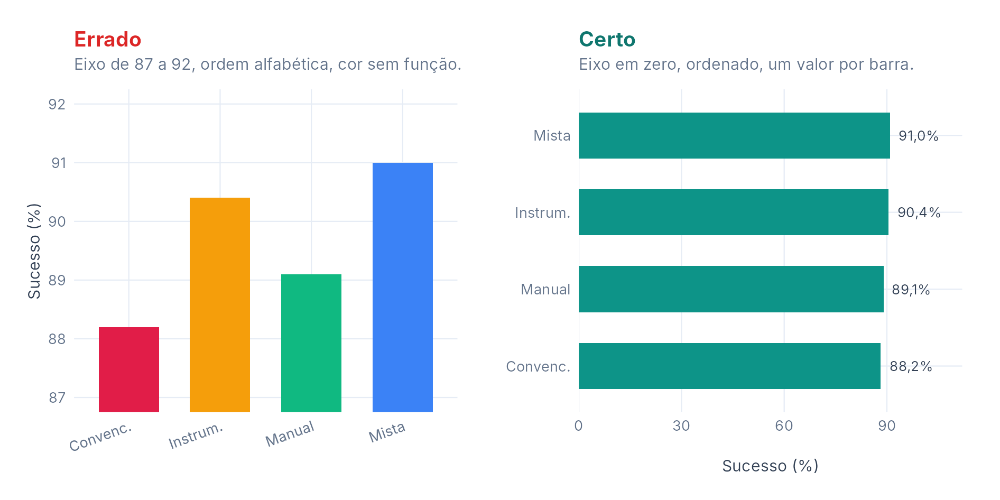

<p class="small">**Figura 4.1** — O mesmo dado, dois desenhos. À esquerda: eixo de 87 a 92, ordem alfabética e uma cor diferente por barra. À direita: eixo de 0 a 100, ordem crescente e o valor escrito na ponta. Dados simulados.</p>

Repare no que muda, além do eixo: a **ordem** (alfabética à esquerda, crescente à direita) e a **cor** (quatro cores sem significado à esquerda, uma cor só à direita). Nenhuma das duas decisões altera o dado; as duas alteram a conclusão que o leitor tira dele. Ordem e cor são informação, não decoração.

::: {.callout-tip}
## Uso correto do gráfico de barras

"Proporção de pacientes com anemia, por grupo (n = 60 e n = 58)" — eixo y de 0 a 40%, barras ordenadas pela frequência, o $n$ escrito no rótulo de cada barra e a unidade no eixo.

Três decisões que bastam: **eixo em zero**, **$n$ visível** e **ordem que signifique algo**.
:::

::: {.callout-warning}
## Uso incorreto do gráfico de barras

**Eixo cortado em 8,3** com valores entre 8,4 e 9,0: dois valores que diferem 7% viram barras de alturas 7 vezes diferentes.

**Barras de média com barrinha de erro** — esconde a distribuição e, sem legenda, não se sabe se o erro é DP, EPM ou IC.

**Efeito 3D** — a profundidade desloca a leitura da altura e não acrescenta informação.

**Ordem alfabética** quando a informação está na ordem (leve, moderado, grave) — e ordem decrescente quando você quer destacar o maior valor.
:::

### Empilhadas (e 100%): quando a pergunta é a composição

Quando a categoria se divide em subcategorias — grupo de tratamento × desfecho (melhora, estável, piora) —, existem três desenhos possíveis, e cada um responde a uma pergunta diferente.

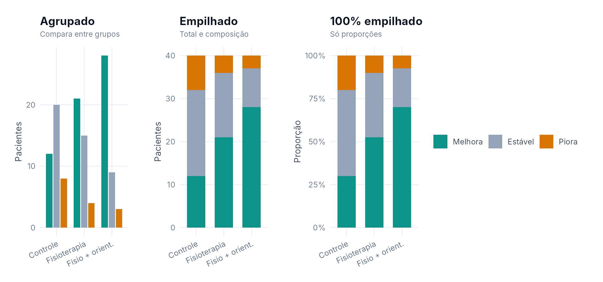

<p class="small">**Figura 4.2** — Três desenhos para a mesma tabela de contingência: 3 grupos de 40 pacientes cada, classificados em melhora, estável ou piora. Dados simulados.</p>

| Desenho | Responde | Cuidado |
|:--|:--|:--|
| **Agrupado** (dodged) | "quantos pacientes em cada desfecho, por grupo?" | com muitas subcategorias, as barras ficam finas e difíceis de comparar |
| **Empilhado** | "qual o total e como ele se compõe?" | a comparação entre grupos fica presa à base comum; só a primeira fatia tem base alinhada |
| **100% empilhado** | "qual a proporção de cada desfecho, por grupo?" | **esconde o $n$**: dois grupos com 10 e 100 pacientes parecem iguais |

O 100% empilhado é o único dos três em que a comparação de proporções é honesta — mas ele só é honesto se o $n$ aparecer na legenda. É o gráfico certo para "a proporção de melhora foi 30%, 52,5% e 70% nos três grupos"; é o gráfico errado para "quantos pacientes melhoraram".

### Pizza: quase nunca

A pizza só funciona quando as fatias somam 100%, são no máximo quatro ou cinco e a diferença entre elas é grande. O olho humano compara mal ângulos: com 12 categorias, a pizza vira legenda colorida — e uma barra ordenada mostraria a mesma informação com precisão.

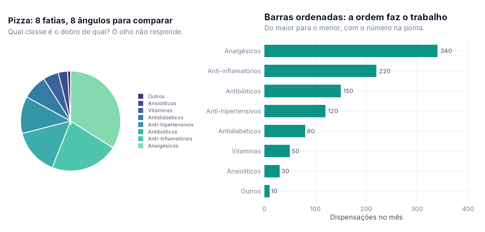

<p class="small">**Figura 4.3** — As mesmas oito categorias de dispensação, em pizza e em barras ordenadas. Na pizza, responder "a primeira classe é o dobro da segunda?" exige medir ângulos com o olho; nas barras, a resposta está na ordem e no número. Dados simulados.</p>

Note o detalhe: a pizza tem **8 fatias** e a maior delas (340) é mais de dez vezes a menor (10). Mesmo nesse caso extremo — o mais favorável possível —, comparar a primeira com a segunda fatia é difícil. Com fatias parecidas, é impossível.

Se você precisa mostrar "parte de um todo" com poucas categorias, uma **barra empilhada única** (ou um *donut* com o total no centro) resolve melhor que a pizza, porque todas as partes ficam sobre a mesma linha de base. E se o leitor precisa comparar valores, o gráfico é de barras — não há terceira opção.

### Pirâmide etária: duas categorias, um eixo central

Quando duas categorias dividem cada grupo (homens e mulheres, por faixa de idade; casos e controles, por exposição), a **pirâmide** coloca as duas barras de costas uma para a outra, com o eixo no centro. O formato geral — a silhueta — aparece imediatamente, o que é exatamente o que se quer mostrar.

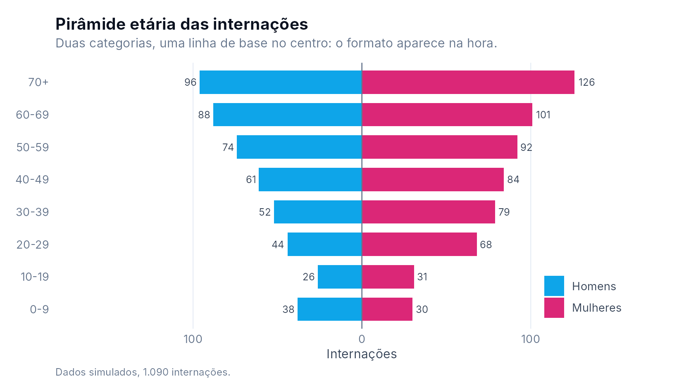

<p class="small">**Figura 4.4** — Pirâmide etária de 1.090 internações simuladas em uma clínica-escola. O eixo central é a linha de zero; os números ao lado de cada barra são as contagens absolutas. Dados simulados.</p>

Dois cuidados: o eixo central precisa estar em **zero** (senão os dois lados ficam deslocados) e a escala dos dois lados tem de ser **a mesma** — se um lado vai até 160 e o outro até 100, a comparação visual é falsa. Repare que a mulher idosa (126 internações na faixa 70+) é o grupo mais frequente: uma informação que uma tabela de 16 números esconde e a silhueta entrega.

### Boxplot: comparar grupos sem se perder

O boxplot é ótimo para **comparar** distribuições lado a lado, porque alinha medianas e caixas na mesma escala. É o gráfico padrão para "tempo de internação por grupo de tratamento", "glicemia por turno de coleta", "CPO-D por escola".

Como todo resumo, ele perde informação — e a perda mais grave é o $n$. Um boxplot com 4 observações e outro com 400 podem ter exatamente a mesma aparência. Por isso, com menos de ~20 observações por grupo, desenhe os pontos junto.

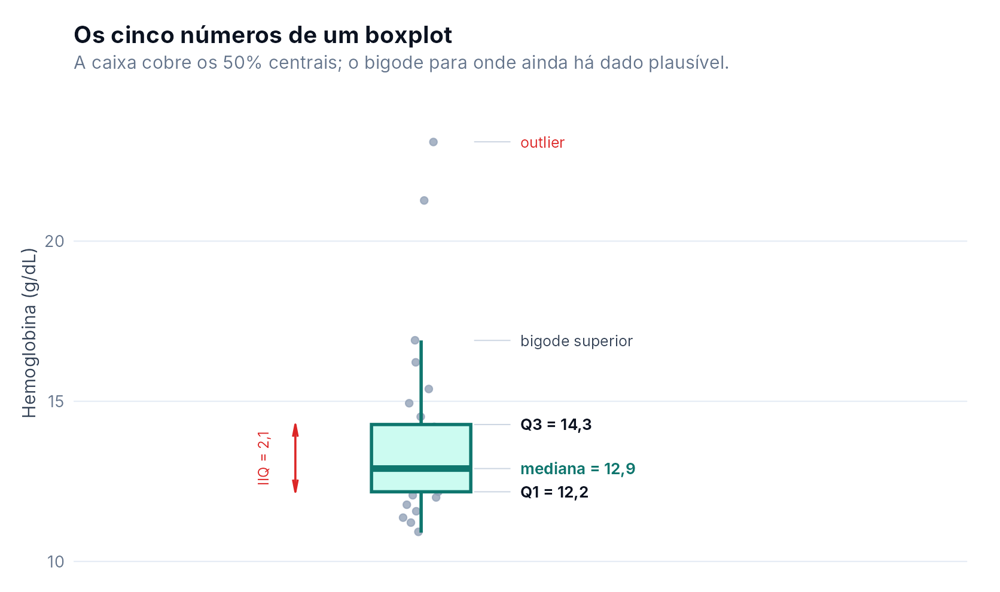

<p class="small">**Figura 4.5** — Anatomia do boxplot com os 28 valores à mostra. A caixa vai de $Q_1$ a $Q_3$; a linha grossa é a mediana; o bigode vai até o valor mais extremo que ainda está dentro de $1{,}5 \times \text{IIQ}$ da caixa; o que passa disso é desenhado como ponto. Dados simulados.</p>

Vale conferir a conta na figura: $Q_1 = 12{,}2$, mediana $= 12{,}9$, $Q_3 = 14{,}3$, IIQ $= 2{,}1$. A cerca superior é $14{,}3 + 1{,}5 \times 2{,}1 = 17{,}45$; o maior valor abaixo disso é 16,9 — o fim do bigode. Os valores 21,3 e 23,1 ficam fora e aparecem como pontos. **O boxplot é, literalmente, uma cerca desenhada.**

### Dados pareados: cada paciente é uma linha

Quando a mesma pessoa é medida antes e depois, a unidade de análise é o **par**, não a média de cada momento. O gráfico certo liga os dois valores do mesmo paciente com uma linha: o que interessa é a inclinação individual, e não a altura média dos dois grupos.

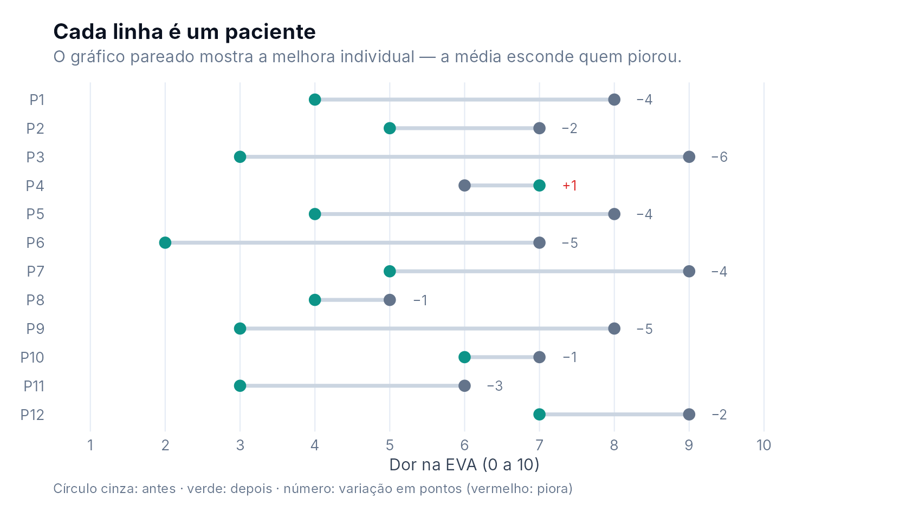

<p class="small">**Figura 4.6** — Dor na EVA (0 a 10) antes e depois de 12 pacientes. Cada linha é um paciente; o número à direita é a variação em pontos, em vermelho quando houve piora. Dados simulados.</p>

Onze dos doze pacientes melhoraram, mas **um piorou** (P4, de 6 para 7). Uma tabela com "EVA média: 7,4 antes, 4,1 depois" resume o grupo e apaga esse paciente — que é justamente quem o clínico precisa discutir. O gráfico pareado (*slope chart* ou *dumbbell*) mantém o indivíduo visível, que é o que a estatística pareada pressupõe.

### Linhas e séries temporais: tendência, sazonalidade e intervenção

Linha conecta pontos porque existe continuidade entre eles. Use para séries temporais (casos por mês, tendência de vendas), nunca para categorias sem ordem — uma linha entre "farmácia" e "enfermagem" não significa nada.

Uma série temporal bem desenhada responde a três perguntas de uma vez: existe **tendência**? existe **sazonalidade**? algum evento mudou o padrão?

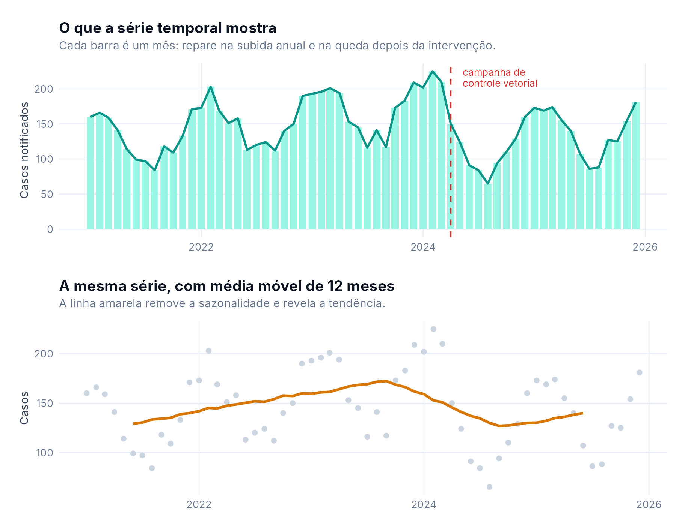

<p class="small">**Figura 4.7** — Série mensal de 60 meses de casos notificados (acima) e a mesma série com média móvel de 12 meses (abaixo). A linha tracejada marca o início de uma campanha de controle vetorial. Dados simulados.</p>

O painel de cima mostra as três coisas ao mesmo tempo: a tendência de alta (cerca de 1,4 caso por mês), o ciclo anual (pico no verão) e a queda depois da intervenção. O painel de baixo aplica uma **média móvel de 12 meses**, que "apaga" o ciclo anual e deixa a tendência visível. Nenhum dos dois está errado: eles respondem a perguntas diferentes.

Três cuidados com séries temporais:

1. **O eixo x é tempo e precisa ter espaçamento constante.** Meses com 28 e 31 dias não distorcem nada; um buraco de seis meses sem dados, sim — e ele precisa ser mostrado, não interpolado em silêncio.
2. **Média móvel de 12 meses perde 6 meses em cada ponta.** O começo e o fim da linha são menos confiáveis que o meio, e é onde costuma estar a conclusão.
3. **"Depois da intervenção" não é "por causa da intervenção".** A queda pode ser sazonal, pode ser artefato de notificação, pode ser regressão à média. Gráfico de série temporal sugere; não demonstra.
### Dispersão: duas variáveis ao mesmo tempo

O diagrama de dispersão mostra cada paciente como um ponto, com uma variável em cada eixo. É o gráfico certo para "a dor cai conforme as sessões aumentam?" ou "a pressão sobe com a idade?".

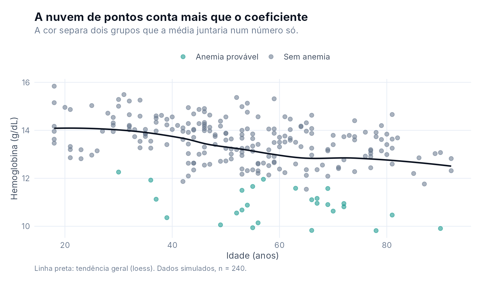

<p class="small">**Figura 4.8** — Hemoglobina por idade em 240 pacientes simulados. A cor separa dois perfis que a média juntaria num número só; a linha preta é uma tendência geral (loess). Dados simulados.</p>

Note o que a figura faz que o coeficiente de correlação não faz: ela mostra **dois grupos** com inclinações diferentes dentro da mesma nuvem. Se você calculasse só a correlação entre idade e hemoglobina, obteria um número moderado e não saberia dizer que existe uma população anêmica puxando a média para baixo. O gráfico não é ilustração do número — às vezes é a única forma de ver a estrutura.

Dois cuidados:

- **Sobreposição**: com muitos pontos, vários caem no mesmo lugar. Use transparência (`alpha`), jitter ou hexbin para mostrar densidade.
- **Escala**: um único paciente com valor extremo pode esmagar todos os outros num canto. Verifique antes de concluir que "não há relação".

E o cuidado conceitual, que vale mais que os dois anteriores: **dispersão mostra associação, não causa**. Uma nuvem com inclinação clara pode ser causada por uma terceira variável (idade, renda, tempo de doença) que não está em nenhum dos eixos.

### Mapa de calor: muitas correlações de uma vez

Com oito variáveis, existem 28 correlações duas a duas. Uma tabela de 28 números é ilegível; um mapa de calor resolve — cor para o valor, posição para o par de variáveis.

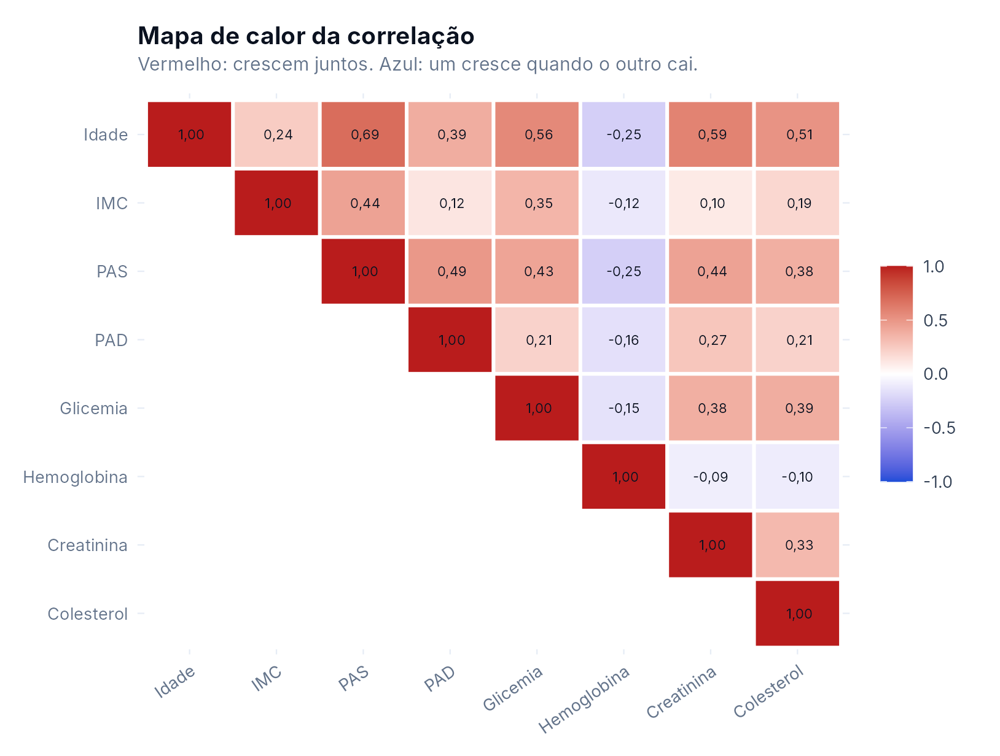

<p class="small">**Figura 4.9** — Correlações de Pearson entre oito variáveis clínicas em 300 pacientes simulados. Azul: correlação negativa; vermelho: positiva; branco: ausência de associação linear. A metade superior é omitida porque a matriz é simétrica. Dados simulados (estrutura de correlação declarada no código que gera a figura).</p>

Boa prática: **mostre o número dentro da célula** quando são poucas variáveis (como aqui), use uma escala **divergente centrada em zero** e não deixe a escala de cor decidir a mensagem. Um detalhe importante: a diagonal é sempre 1 e não informa nada — se ela dominar visualmente (vermelho forte), o resto do mapa desaparece. Vale removê-la ou neutralizá-la.

Mapa de calor também serve para dados que não são correlação: expressão gênica por amostra, resistência bacteriana por antibiótico, adesão por mês. A regra é a mesma — cor para magnitude, e **ordenação** das linhas e colunas por similaridade para que os blocos apareçam (é o que faz a Figura 4.17 adiante).

### Volcano: efeito no eixo x, evidência no eixo y

Quando se comparam milhares de variáveis ao mesmo tempo — genes, proteínas, metabólitos —, o resultado não cabe em tabela. O *volcano plot* resume cada variável em dois números que interessam: **o tamanho do efeito** (no eixo x) e **a força da evidência** (no eixo y, geralmente $-\log_{10}$ do valor de $p$).

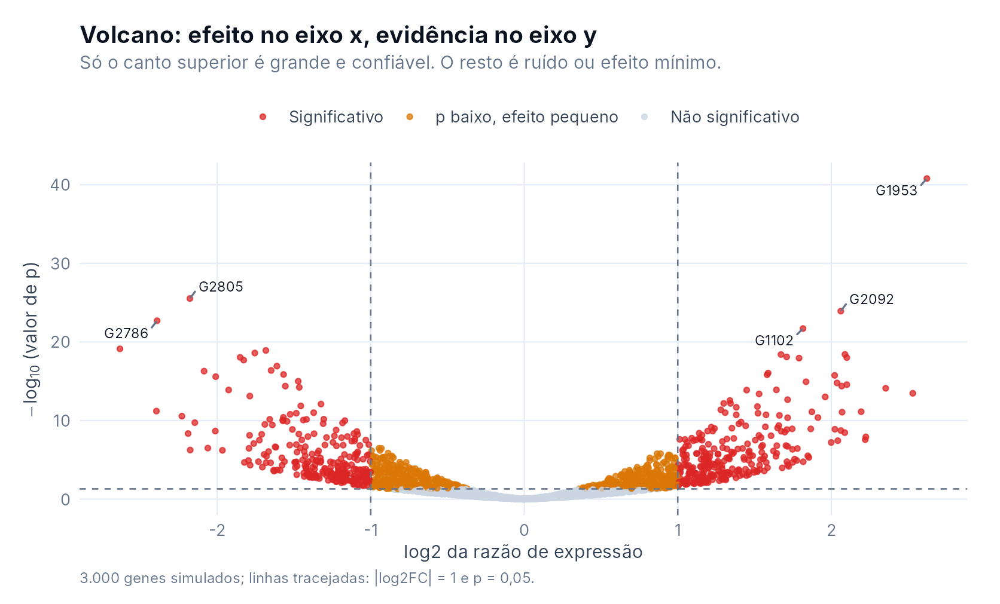

<p class="small">**Figura 4.10** — 3.000 genes simulados. Eixo x: $\log_2$ da razão de expressão; eixo y: $-\log_{10}$ do valor de $p$. As linhas tracejadas marcam $|\log_2\text{FC}| = 1$ e $p = 0{,}05$. Em vermelho, genes grandes **e** confiáveis; em laranja, $p$ baixo com efeito pequeno. Dados simulados.</p>

A leitura é espacial: o canto superior esquerdo e o superior direito são os candidatos. O resto é ruído (perto do eixo x) ou efeito real pequeno demais para importar (faixa do meio). O gráfico foi desenhado justamente para que os candidatos **se destaquem sozinhos**, sem que o leitor precise ler 3.000 valores.

Dois cuidados: o eixo y depende do tamanho da amostra (com $n$ grande, tudo fica "significativo"), e comparar 3.000 genes ao mesmo tempo exige correção para **múltiplas comparações** — o valor de $p$ bruto de 0,05 é esperado por azar em 150 dos 3.000 testes. Um volcano sem correção (FDR) é um gerador de falsos positivos com aparência sofisticada.

### Sobrevida: o tempo até o desfecho

Em muitos estudos o desfecho não é "sim ou não", é **quando**. E aí existe um problema que nenhuma média resolve: alguns pacientes não tiveram o desfecho até o fim do estudo — estão **censurados**. A curva de Kaplan-Meier usa toda a informação disponível, inclusive a de quem saiu antes.

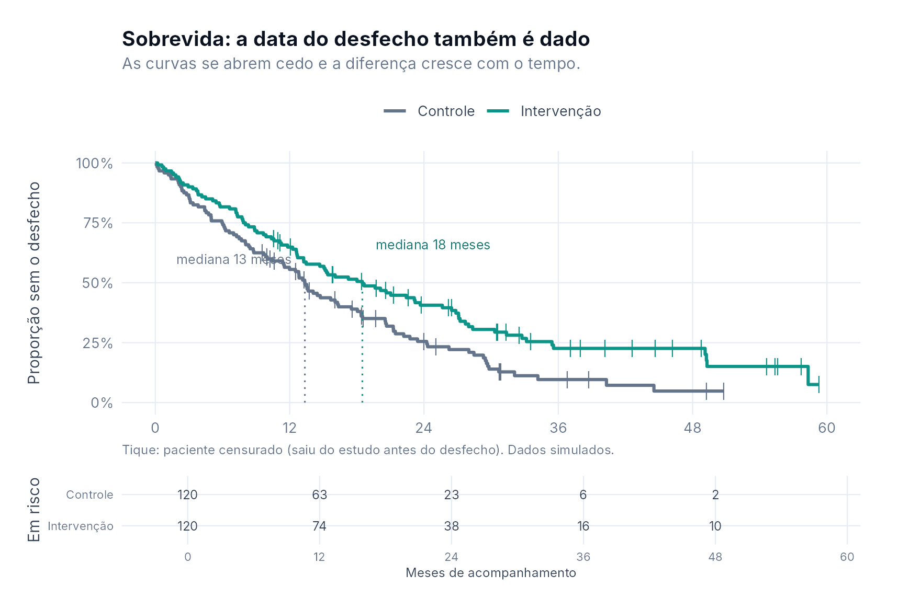

<p class="small">**Figura 4.11** — Curvas de sobrevida de dois braços com 120 pacientes cada (simulados). Os tiques verticais marcam pacientes censurados; as linhas pontilhadas marcam a mediana de cada braço; a tabela embaixo mostra quantos pacientes ainda estavam em risco em cada marco temporal. Dados simulados.</p>

O que a figura ensina:

- **A curva é em degraus**, porque a sobrevida só cai quando alguém tem o desfecho. Não é uma reta "suavizada".
- **Os tiques importam.** Um trecho horizontal longo pode significar "ninguém teve o desfecho" ou "todo mundo saiu do estudo". A censura é informação, não lixo.
- **A tabela de risco é obrigatória.** Depois de 48 meses restam 2 pacientes no controle: qualquer diferença ali é ruído, e a curva não avisa isso sozinha.
- **Mediana, não média.** A mediana de sobrevida é o tempo em que 50% ainda estão sem o desfecho — 13 meses no controle e 18 na intervenção, neste exemplo.

### Forest plot: a síntese da evidência

Quando vários estudos respondem à mesma pergunta, o *forest plot* coloca cada estimativa com seu intervalo de confiança na mesma escala e desenha, embaixo, a estimativa combinada (a metanálise). É o gráfico padrão de revisões sistemáticas — e um dos poucos que mostra **incerteza** explicitamente.

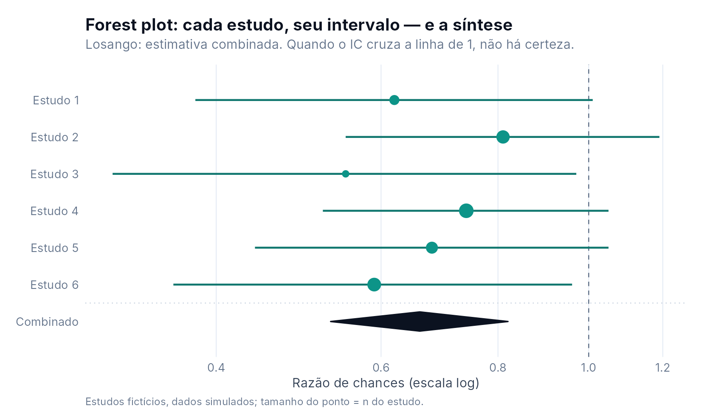

<p class="small">**Figura 4.12** — Seis estudos fictícios (razão de chances e IC 95%) e a estimativa combinada no losango. A linha vertical em 1 é a ausência de efeito; a escala é logarítmica. Estudos fictícios, dados simulados; o tamanho do ponto representa o $n$ do estudo.</p>

A leitura tem três níveis:

1. **Cada estudo**: o ponto é a estimativa; a barra horizontal é o intervalo de confiança. Se a barra cruza a linha de 1, aquele estudo, sozinho, não descarta a ausência de efeito. Aqui, só dois dos seis conseguem isso.
2. **O conjunto**: os estudos apontam na mesma direção (todos à esquerda de 1), com tamanhos diferentes.
3. **A síntese**: o losango é a estimativa combinada (0,66; IC 0,53–0,82) — precisão maior que a de qualquer estudo isolado, porque usa todos.

E o detalhe que faz o forest plot valer a pena: **a síntese pode ser conclusiva mesmo quando nenhum estudo isolado é**. É o argumento mais forte a favor de metanálise — e também o mais perigoso, porque a combinação só faz sentido se os estudos forem comparáveis (mesma população, mesmo desfecho, mesma medida). Um forest plot com estudos heterogêneos é uma média de coisas diferentes com aparência de consenso.
### Treemap (mapa de árvore): hierarquia que cabe na tela

Quando existem duas dimensões de categoria — grupo farmacológico e classe — e um valor para cada combinação, o treemap resolve: cada retângulo tem **área proporcional ao valor**, e os retângulos se aninham dentro do grupo.

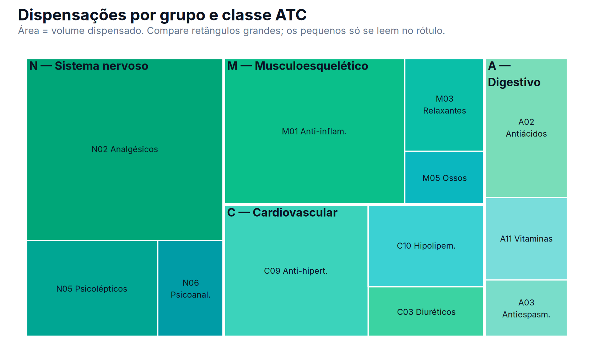

<p class="small">**Figura 4.13** — Dispensações por grupo e classe ATC em uma farmácia-escola. Área = número de dispensações; a hierarquia é grupo (retângulo grande) → classe (retângulo interno). Os códigos ATC são uma classificação pública; os volumes são simulados.</p>

O treemap é ótimo para **mostrar estrutura** — qual grupo domina, quais classes pesam dentro de cada grupo — e ruim para **comparar valores próximos**: áreas de retângulos finos e alongados são notoriamente difíceis de julgar. Por isso: rotule os retângulos grandes, agrupe os pequenos em "outros" e não use treemap quando a pergunta é "qual é maior que qual por 5%".

### Nuvem de palavras: o texto vira figura (com ressalvas)

Respostas abertas, reclamações, títulos de artigo, laudos: todo dado textual pode ser contado, e a nuvem de palavras mostra a frequência como **tamanho da fonte**.

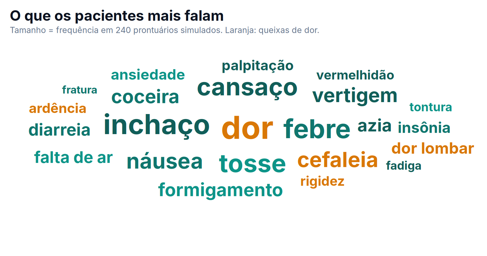

<p class="small">**Figura 4.14** — Queixas registradas em 240 prontuários simulados. Tamanho = frequência da queixa; laranja = queixas que mencionam dor (uma decisão de classificação, não do acaso). Dados simulados.</p>

A nuvem tem três problemas que você precisa conhecer antes de publicá-la:

1. **Área não é linear.** Uma palavra com o dobro da fonte ocupa cerca de **quatro vezes** a área — o olho lê "muito mais" do que a diferença real.
2. **A posição é arbitrária.** O algoritmo empacota as palavras onde cabe; perto do centro não significa mais importante. Numa nuvem, o leitor procura por posição e não encontra padrão.
3. **Não tem escala nem eixo.** Não há como ler "quantas vezes" cada palavra apareceu — e duas nuvens nunca são comparáveis entre si.

Ela funciona como **convite**, não como análise: abre uma seção, sugere hipóteses, orienta a leitura. Para comunicar de verdade, acompanhe com um gráfico de barras das 10 palavras mais frequentes, ou com a árvore de palavras abaixo — que preserva a contagem e o contexto.

### Árvore de palavras: a frase inteira, ramo por ramo

A nuvem conta palavras soltas; a **árvore de palavras** (*word tree*) mantém a frase: cada caminho da raiz até a folha é uma resposta completa, e a espessura do ramo é quantas pessoas disseram aquilo.

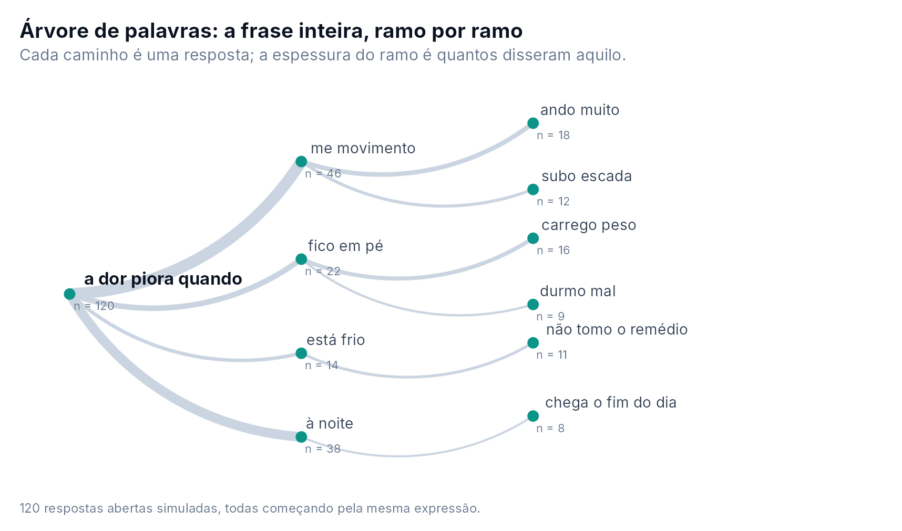

<p class="small">**Figura 4.15** — 120 respostas abertas simuladas à pergunta "quando a sua dor piora?". Todas começam pela mesma expressão; os ramos mostram o que vinha depois. $n$ em cada nó. Dados simulados.</p>

Aqui a contagem é explícita ($n = 120$ na raiz, 46 em "me movimento", 38 em "à noite") e o contexto aparece: "me movimento" se desdobra em andar, subir escada e carregar peso — três situações diferentes que uma nuvem de palavras trataria como "movimento" e perderia. É o gráfico certo quando a pergunta é **qualitativas e a resposta é uma frase**, e não uma palavra.

O custo é o trabalho: alguém precisa ler, codificar e agrupar as respostas. Não existe versão automática confiável.

### Redes: quem se conecta com quem

Nem todo dado é uma tabela de indivíduos independentes. Contatos entre pessoas, interações entre proteínas, coautoria, prescrição concomitante: aqui a unidade é o **par** (quem com quem), e o gráfico natural é a rede — nós e arestas.

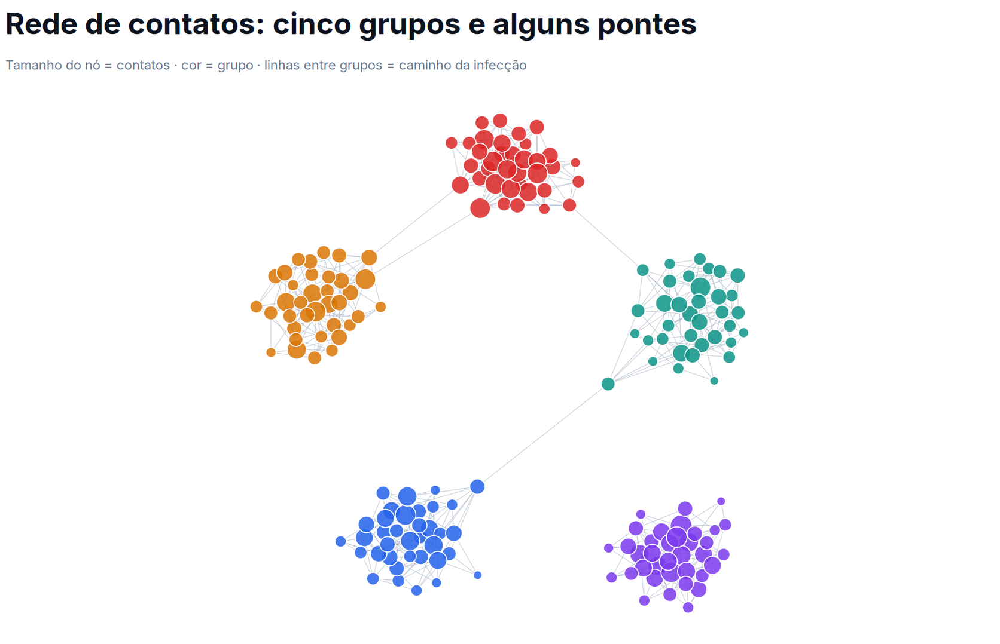

<p class="small">**Figura 4.16** — Rede de contatos simulada com 180 pessoas em cinco grupos (família, escola, trabalho, vizinhança, igreja). Tamanho do nó = número de contatos; cor = grupo; as linhas finas entre grupos são as pontes por onde a transmissão passa de um grupo a outro. Dados simulados.</p>

O que a rede mostra e uma tabela não mostraria: **a topologia**. Cinco grupos densos e algumas poucas pontes entre eles — e são as pontes que determinam se um surto fica contido num grupo ou se espalha. Nenhuma coluna de planilha tem essa informação; ela está na *ausência* de linhas.

Três cuidados: o **layout é arbitrário** (posições não são geografia nem hierarquia), o **grau** (número de contatos) não é risco por si só — depende da transmissibilidade e da duração do contato —, e redes com muitos nós viram "novelo" e precisam de filtro (só os 50 maiores graus, só as arestas mais fortes).

### Similaridade: fármacos que se parecem

A mesma ideia de rede, aplicada a **perfis**, resolve uma pergunta frequente em farmácia e em farmacovigilância: quais fármacos se parecem? Basta transformar cada fármaco em um vetor (a frequência de cada evento adverso) e medir a semelhança entre os vetores.

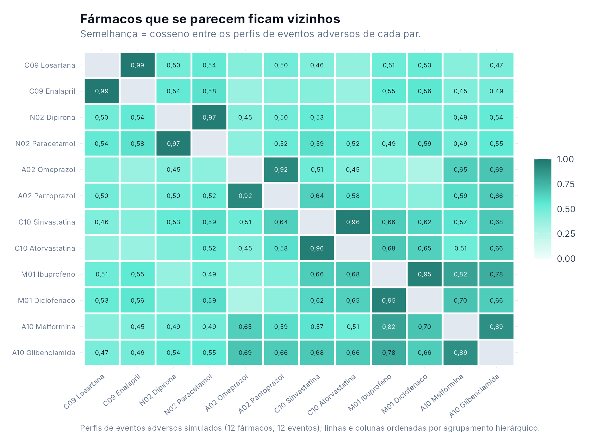

<p class="small">**Figura 4.17** — Similaridade entre 12 fármacos a partir do perfil de 12 eventos adversos. A medida é o cosseno entre os perfis (0 = nada em comum; 1 = idênticos). As linhas e colunas foram ordenadas por agrupamento hierárquico, e é isso que faz os pares da mesma classe aparecerem juntos na diagonal. Perfis simulados; os códigos ATC são reais.</p>

A figura tem duas leituras. A primeira é a **diagonal em blocos**: os pares da mesma classe terapêutica ficam lado a lado porque compartilham os mesmos eventos marcadores — o agrupamento foi descoberto nos dados, não imposto. A segunda é a **semelhança secundária** entre anti-inflamatórios (M01) e antidiabéticos (A10), que compartilham eventos gastrointestinais. Isso não quer dizer que sejam intercambiáveis: quer dizer que **produzem um perfil parecido de efeitos adversos**, o que é exatamente a informação útil quando se quer evitar associação de fármacos com toxicidade sobreposta.

O cuidado essencial: **similaridade não é equivalência terapêutica**. Dois fármacos podem ter perfis de eventos quase idênticos e mecanismos completamente diferentes — e vice-versa. O mapa mostra padrão; a interpretação exige farmacologia.

### Como um gráfico engana

<iframe class="w-frame" src="widgets/eixo-truncado.html" title="Como cortar o eixo y distorce a comparação entre barras" loading="lazy"></iframe>

<p class="small">Arraste o início do eixo para 1,1 e observe: o dado não mudou, mas a diferença entre o controle e o grupo "A + B" passou a parecer 20 vezes maior do que é. No gráfico de barras, a área é a mensagem — e é por isso que cortar o eixo nele é enganoso, enquanto no gráfico de linhas é aceitável (ali o que importa é a variação, não a distância até zero).</p>

Os truques mais comuns, todos encontrados em artigos e em material de marketing:

1. **Eixo truncado** em gráfico de barras — a diferença parece maior do que é.
2. **Escala logarítmica sem aviso** — achata crescimentos enormes e esconde a magnitude.
3. **Área ou volume** — um círculo com o dobro do diâmetro tem quatro vezes a área; o leitor lê "duas vezes".
4. **Efeito 3D** — a profundidade desloca a leitura das alturas e não acrescenta informação.
5. **Eixo duplo** — duas escalas no mesmo gráfico permitem criar qualquer correlação visual que se queira.
6. **Cores e ordem** — ordenar as categorias de forma conveniente sugere tendência onde não há.
7. **Pizza com muitas fatias** — ângulos pequenos são indistinguíveis.

::: {.keybox}
**As cinco regras de ouro**

1. O eixo de barras começa em zero.
2. Mostre o $n$ — no título, na legenda ou no eixo.
3. Uma figura, uma mensagem: se o gráfico precisa de três parágrafos para ser entendido, ele não está pronto.
4. Rotule eixos com **nome da variável e unidade**.
5. Se o gráfico for cortado, distorcido ou transformado, **avise na legenda**.
:::

## O que faz um gráfico moderno funcionar

Os gráficos deste capítulo parecem sofisticados, mas nenhum deles é sofisticado por enfeite: cada um resolve um problema de comunicação que o gráfico de barras não resolve. O que os torna bons é um conjunto pequeno de decisões, e elas valem para qualquer gráfico — do mais simples ao mais elaborado.

| Decisão | Como se faz | Por que importa |
|:--|:--|:--|
| **Título com a mensagem** | "A queda só aparece depois do 40º mês", não "Casos por mês" | o leitor entende a conclusão antes de decodificar o eixo |
| **Rótulo direto** | valor ou nome na ponta da barra/linha, em vez de legenda com cores | elimina a ida e volta entre figura e legenda |
| **Ordem com sentido** | crescente, cronológica, por grupo — nunca alfabética por acaso | a ordem é informação; o acaso não deve decidir |
| **Base zero para área** | barras e áreas sempre a partir de zero | a área é a mensagem; cortar o eixo falseia a proporção |
| **Cor com significado** | uma cor para "antes", outra para "depois"; uma para "significativo" | cor sem regra é ruído e ocupa o canal mais forte do olho |
| **Pouca cor, bem usada** | uma cor de destaque + cinzas para o contexto | o olho vai para o que você destacou |
| **Anotação no ponto** | seta, texto ou faixa marcando o evento importante | dispensa parágrafo explicativo e ancora a leitura |
| **Incerteza visível** | intervalo de confiança, faixa, barras de erro legendadas | um número sem incerteza parece mais firme do que é |
| **$n$ em toda figura** | no subtítulo, no eixo ou no rótulo | 4 e 400 pacientes não podem parecer a mesma coisa |
| **Uma mensagem por figura** | se precisa de três parágrafos, divida em três figuras | figura que explica tudo não explica nada |

### Small multiples: o padrão que resolve quase tudo

Quando você tem a mesma medida em muitos grupos (hospitais, municípios, meses, espécies), em vez de um gráfico gigante com 20 cores, faça **vários pequenos gráficos com a mesma escala**, lado a lado. O olho compara padrões entre painéis com muito mais eficiência do que compara 20 linhas sobrepostas. É a técnica por trás dos painéis de indicadores que você vê em *Our World in Data*, no *Financial Times* e nos relatórios de vigilância em saúde — e ela é fácil de implementar: `facet_wrap()` no R faz isso em uma linha.

### Tipos que valem conhecer (e quando cada um se paga)

| Gráfico | Serve para | Cuidado |
|:--|:--|:--|
| **Small multiples** | mesma medida em muitos grupos | escala idêntica entre painéis; sem isso, a comparação é falsa |
| **Slope / dumbbell** | antes e depois no mesmo indivíduo | com muitos indivíduos, destaque os extremos e deixe o resto em cinza |
| **Beeswarm / raincloud** | distribuição com $n$ pequeno, sem esconder pontos | pode virar bagunça acima de ~200 pontos; combine com boxplot |
| **Ridgeline** | muitas distribuições empilhadas (turnos, meses, escolas) | sobreposição dificulta leitura dos valores exatos |
| **Hexbin / densidade 2D** | dispersão com milhares de pontos | a escala de cor precisa de legenda explícita |
| **Alluvial / Sankey** | fluxo entre estados (diagnóstico → tratamento → desfecho) | com muitas categorias, vira espaguete; agrupe |
| **Gráfico de pontos com IC** | comparação de médias entre grupos | é o substituto honesto das barras de média com erro |
| **Bullet / termômetro** | meta versus realizado | não use para distribuição: é indicador, não dado bruto |
| **Mapa coroplético** | padrão geográfico | área grande domina a percepção; normalize por população |
| **Animação / scrollytelling** | contar uma história em etapas | nunca a única versão: quem imprime ou revisa precisa da figura estática |

Duas regras fecham esta seção. A primeira: **o gráfico mais impressionante é o que o leitor entende sem ajuda** — não o que tem mais camadas. A segunda: **se você precisou explicar o gráfico no texto, o gráfico ainda não está pronto**. Uma figura boa carrega a mensagem sozinha; o texto ao lado diz o que fazer com ela.

## Tabelas que comunicam

Uma tabela bem feita permite ao leitor comparar números sem esforço. Uma tabela ruim obriga a fazer contas de cabeça — e é aí que os erros de leitura começam.

### As sete regras

1. **Unidade no cabeçalho**, não no corpo: "Hemoglobina (g/dL)" e não "13,2 g/dL" em cada célula.
2. **Casas decimais consistentes** dentro da mesma coluna: 45,3 e 47,0 — nunca 45,3 e 47.
3. **Todo símbolo tem legenda**: "±" é DP, EPM ou IC? A legenda responde, e a mesma convenção vale para o artigo inteiro.
4. **Porcentagem sempre com denominador**: "32% (19/60)", porque 32% de 60 e 32% de 600 não são a mesma evidência.
5. **$n$ em cada grupo**, no cabeçalho ou na primeira coluna.
6. **Números alinhados à direita ou ao centro** (vírgula sob vírgula), texto à esquerda.
7. **Ordem lógica**: por grupo, por frequência decrescente ou cronológica — nunca alfabética por acidente.

### A mesma tabela, errada e certa

**Errado:**

| Grupo | Idade | Hemoglobina | Anemia |
|:--|:--|:--|:--|
| A | 45,3 | 13,2 ± 1,5 | 32% |
| B | 47 | 12,8 ± 1,4 | 28,4% |

O que está errado: idade com uma casa decimal em um grupo e nenhuma no outro; "±" sem dizer se é DP ou EPM; porcentagem sem denominador; nenhum $n$; unidade ausente no cabeçalho; "Grupo A" e "Grupo B" sem dizer o que são.

**Certo:**

| Grupo | n | Idade (anos) | Hemoglobina (g/dL) | Anemia, n (%) |
|:--|--:|--:|--:|--:|
| Controle | 60 | 45,3 (12,1) | 13,2 (1,5) | 19 (31,7) |
| Fisioterapia | 58 | 47,0 (11,8) | 12,8 (1,4) | 16 (27,6) |

*Valores são média (DP), exceto n e Anemia, n (%).*

A segunda tabela diz, sem ambiguidade, quantos pacientes há em cada grupo, o que significam os parênteses, qual é a unidade e qual é o denominador de cada porcentagem. Um revisor não tem o que pedir; um leitor não tem o que supor.

### A Tabela 1 do artigo

A "Tabela 1" é a primeira tabela de quase todo artigo clínico: o retrato dos participantes, variável por variável, grupo por grupo. Ela responde a três perguntas: quem são os pacientes, os grupos são comparáveis, e o sorteio funcionou?

No R, o pacote `gtsummary` gera essa tabela em poucas linhas:

```r
#| eval: false
library(gtsummary)
library(dplyr)

dados_clinicos %>%
  select(idade, sexo, tratamento, resposta_tumoral) %>%
  tbl_summary(by = tratamento,
              statistic = list(all_continuous() ~ "{mean} ({sd})",
                               all_categorical() ~ "{n} ({p}%)"),
              missing = "ifany") %>%
  add_p() %>%
  bold_labels()
```

Se os grupos já diferem na Tabela 1 em variáveis que importam para o desfecho, qualquer comparação posterior nasce suspeita. E note: incluir ou não valor de *p* na Tabela 1 é um debate em aberto na literatura — muitos periódicos desaconselham, porque a Tabela 1 é descritiva, não inferencial. O que não se discute é a necessidade de mostrar $n$ e a medida de dispersão.

::: {.callout-warning}
## Erros de tabela que custam revisão

**Coluna "média ± DP" com categorias dentro** — "3,2 ± 0,19; 4 casos leves" na mesma célula. Cada tipo de variável merece sua própria coluna.

**Percentual que não fecha** — colunas que somam 98% ou 102% por arredondamento sem nota de rodapé.

**Abreviações sem legenda** — "PCR", "Hb", "IMC" podem ter mais de um significado na área da saúde.

**Tabela com 12 colunas** — se não cabe na página, o leitor não compara nada. Considere dividir em duas ou inverter linhas e colunas.
:::

## Outliers: erro, achado ou outra população

Todo conjunto real tem valores que fogem do padrão, e eles são de três tipos:

1. **Erro de digitação ou de unidade** — 800 em vez de 80; 2,5 g/dL de hemoglobina em vez de 12,5; pressão em mmHg digitada em cmH₂O.
2. **Erro de medição** — aparelho descalibrado, amostra hemolisada, paciente que não estava em jejum.
3. **Evento real** — o paciente com glicemia de 420 mg/dL que existe, está internado e é justamente o caso que interessa.

A conduta muda conforme o tipo:

- **Verifique na fonte** (prontuário, ficha, laudo) antes de qualquer decisão.
- **Nunca apague em silêncio.** O famoso "limpei os outliers" é uma das formas mais eficientes de transformar um resultado verdadeiro em um resultado bonito.
- **Faça análise de sensibilidade:** repita a análise com e sem os valores suspeitos e relate as duas. Se a conclusão muda, o achado depende de um único paciente — e o leitor tem o direito de saber.
- **Se o valor é real, ele é dado.** Relate a mediana (robusta) ou um método que acomode a cauda, e discuta o caso.

::: {.callout-note}
## Critérios usuais, não leis

O critério mais usado em boxplot é "ponto além de $1{,}5 \times \text{IIQ}$". Outro critério é o escore $z$ acima de 3 (ou seja, três desvios padrão da média). Nenhum dos dois prova que o valor é erro: eles apenas dizem "olhe com atenção". O julgamento é clínico, não aritmético.
:::

## Checklist antes de fechar a análise

| Verificação | Pergunta que você faz |
|:--|:--|
| Faixa de valores | Existe valor impossível (idade 250, FC 800, glicemia negativa)? |
| Valores ausentes | Quantos faltam em cada variável? Faltam mais em um grupo? |
| Distribuição | A variável é simétrica ou tem cauda? |
| Medida relatada | Média com DP ou mediana com IIQ — a escolha combina com a forma? |
| Dispersão | Todo número relatado vem com $n$ e com a medida de dispersão? |
| Gráfico | O tipo combina com a variável? O eixo começa em zero? O $n$ aparece? |
| Tabela | Unidades, decimais, legendas e denominadores estão explícitos? |
| Outliers | Foram verificados na fonte? A análise sem eles muda a conclusão? |
| Unidade de análise | Cada linha da planilha é uma observação independente? |

## No R, passo a passo

Rode os blocos abaixo direto no navegador. Nada precisa ser instalado.

```{webr-r}
glicemia <- c(90, 95, 100, 105, 110, 800)

media   <- mean(glicemia)
mediana <- median(glicemia)
dp      <- sd(glicemia)
iiq     <- IQR(glicemia)

round(c(media = media, mediana = mediana, dp = dp, iiq = iiq), 2)
quantile(glicemia, c(.25, .50, .75))
boxplot(glicemia, col = "#0d9488", ylab = "Glicemia (mg/dL)")
```

<p class="small">Troque o 800 por 130, rode de novo e compare. Depois troque por 80: a média desce mais do que a mediana? Por quê?</p>

Agora a mesma conta **na unha**, para conferir que as funções do R não fazem mágica — elas apenas aplicam as fórmulas desta seção:

```{webr-r}
glicemia <- c(90, 95, 100, 105, 110, 120)
n <- length(glicemia)

media      <- sum(glicemia) / n
desvios    <- glicemia - media
variancia  <- sum(desvios^2) / (n - 1)
dp         <- sqrt(variancia)

c(media_na_unha = media, media_funcao = mean(glicemia))
c(var_na_unha = variancia, var_funcao = var(glicemia))
c(dp_na_unha = dp, dp_funcao = sd(glicemia))

sum(desvios)   # zero: a soma dos desvios em torno da media e sempre zero
```

E a média geométrica, que o R não tem como função pronta (`exp(mean(log(x)))` é a definição):

```{webr-r}
titulos <- c(40, 80, 160)
c(aritmetica = mean(titulos),
  geometrica = exp(mean(log(titulos))))
```

A aritmética dá 93,3 — um título que não existe na série de diluições. A geométrica dá 80, o título central. É a diferença entre "somar grandezas" e "somar logaritmos".

```{webr-r}
# os dois analgesicos do exemplo da secao anterior
A <- c(3.0, 3.2, 3.4, 3.0, 3.4, 3.2, 3.0, 3.4)
B <- c(6.0, 6.2, 6.0, 6.2, 0.2, 0.4, 0.2, 0.4)

round(c(media_A = mean(A), dp_A = sd(A)), 2)
round(c(media_B = mean(B), dp_B = sd(B)), 2)

boxplot(A, B, names = c("A", "B"),
        col = c("#0d9488", "#d97706"),
        ylab = "Redução da dor (EVA)")
```

As médias são iguais e os desvios padrão não. O boxplot mostra o que a média escondeu: em B, a caixa cobre quase toda a escala.

## O que levar deste capítulo

::: {.incremental}
- **Explore antes de testar.** Dado sujo gera resultado com aparência de rigor.
- **Centro e dispersão andam juntos.** Média sem desvio padrão é meia informação — e mediana sem IIQ também.
- **A forma decide a medida.** Simétrica: média e DP. Assimétrica ou ordinal: mediana e IIQ.
- **A média é uma escolha, não uma conta.** Aritmética para grandezas que se somam, geométrica para as que se multiplicam (títulos, diluições), harmônica para taxas, ponderada quando as observações têm pesos diferentes.
- **A variância venceu pelos quadrados.** Ela tem fórmula fechada, se decompõe em partes e soma para variáveis independentes — vantagens que a amplitude e o desvio médio absoluto não têm. O preço é a sensibilidade a extremos.
- **DP descreve pacientes; EPM descreve a estimativa.** Confundir os dois é o erro mais comum das revistas.
- **O gráfico segue o tipo da variável.** Histograma para uma contínua, boxplot para comparar grupos, dispersão para duas quantitativas, barras para categorias — sempre começando em zero.
- **Cada gráfico tem um problema que ele resolve.** Barras ordenadas para comparar, boxplot para distribuições, linha para tempo, forest para síntese de evidência, mapa de calor para muitas correlações, rede para relações. Sofisticação sem pergunta é enfeite.
- **A largura da classe muda o histograma.** Se a forma só aparece com uma escolha específica, suspeite.
- **Tabela boa não faz o leitor calcular.** Unidade no cabeçalho, decimais consistentes, $n$ e legendas explícitos.
- **Outlier é pergunta, não incômodo.** Verifique, relate a análise de sensibilidade, nunca apague em silêncio.
:::

## 🧠 Exercícios de fixação {#exercicios}

*A cada acesso, 3 novas questões são sorteadas. Teve dúvida em alguma? Anote o ID da questão e chame o Tutor Virtual no canto inferior direito!*

::: {.questao-banco}
**Questão #CAP4-01**
```quizdown
# Uma amostra de 6 pacientes tem glicemias 90, 95, 100, 105, 110 e 800 mg/dL. O valor 800 é claramente um erro de digitação. Qual medida de centro descreve melhor esse grupo?
- [ ] A média, 216,7 mg/dL.
  > **Incorreto.** A média usa todos os valores e por isso é arrastada pelo erro: 216,7 não descreve nenhum dos seis pacientes.
- [x] A mediana, 102,5 mg/dL.
  > **Correto!** A mediana depende só da posição central e praticamente não se move com um valor extremo.
- [ ] A amplitude, 710 mg/dL.
  > **Incorreto.** Amplitude é medida de dispersão, não de centro — e ela também é destruída pelo valor extremo.
- [ ] A moda, que não pode ser calculada.
  > **Incorreto.** A moda existe, mas em variável contínua com seis valores distintos é pouco informativa.
```
:::

::: {.questao-banco}
**Questão #CAP4-02**
```quizdown
# Por que o desvio padrão é relatado com mais frequência do que a variância num artigo da área da saúde?
- [ ] Porque o desvio padrão sempre tem valor menor que a variância.
  > **Incorreto.** Ele é menor apenas quando a variância passa de 1; com variância 0,25 o desvio padrão é 0,5.
- [x] Porque ele está na mesma unidade da variável, e o leitor consegue interpretá-lo.
  > **Correto!** Um desvio padrão de 1,5 g/dL fala de hemoglobina; uma variância de 2,25 g/dL ao quadrado não tem leitura clínica.
- [ ] Porque a variância não pode ser calculada em amostras pequenas.
  > **Incorreto.** Ela pode — a divisão por n menos 1 existe justamente para corrigir o viés em amostras pequenas.
```
:::

::: {.questao-banco}
**Questão #CAP4-03**
```quizdown
# Num prontuário, a dor foi registrada como 1 = leve, 2 = moderada e 3 = intensa. A média encontrada foi 2,3. Qual é o problema?
- [ ] Nenhum: 2,3 é a dor média e pode ser relatado.
  > **Incorreto.** Média de códigos não tem unidade nem significado: 2,3 não é uma dor entre moderada e intensa.
- [x] A média de uma variável ordinal não tem interpretação; o correto é mediana ou distribuição de frequências.
  > **Correto!** Para variável ordinal, a informação está na ordem e na frequência de cada categoria, não na média dos códigos.
- [ ] O problema é o tamanho da amostra.
  > **Incorreto.** O problema é o tipo de variável, não o número de pacientes.
```
:::

::: {.questao-banco}
**Questão #CAP4-04**
```quizdown
# Em qual situação a moda é a medida de centro mais informativa?
- [x] Tipo de parto, com as categorias cesárea, vaginal e fórceps.
  > **Correto!** Em variável nominal, a moda (a categoria mais frequente) é a única medida de centro que faz sentido.
- [ ] Hemoglobina de 240 pacientes.
  > **Incorreto.** Em variável contínua, quase todo valor aparece uma vez e a moda é instável.
- [ ] Idade dos pacientes, de 18 a 90 anos.
  > **Incorreto.** Idade é numérica: a moda seria apenas o valor mais repetido, sem resumir a distribuição.
- [ ] Tempo de internação em dias.
  > **Incorreto.** Tempo é contínuo e assimétrico: mediana e intervalo interquartil resumem melhor.
```
:::

::: {.questao-banco}
**Questão #CAP4-05**
```quizdown
# Os tempos de internação de cinco pacientes foram 3, 4, 4, 5 e 24 dias. O 24 é um caso real, confirmado no prontuário. O que acontece com as medidas de centro?
- [x] A média sobe para 8 dias e a mediana continua 4.
  > **Correto!** A soma é 40 e a média vale 8; a mediana continua na posição central, que é 4.
- [ ] A média e a mediana sobem na mesma proporção.
  > **Incorreto.** A mediana depende da posição, não da magnitude: ela não se move quando muda o valor mais alto.
- [ ] A mediana sobe para 8 e a média continua 4.
  > **Incorreto.** É o contrário: quem usa todos os valores é a média.
```
:::

::: {.questao-banco}
**Questão #CAP4-06**
```quizdown
# Um conjunto de hemoglobinas tem média 13,4 e mediana 13,5 g/dL. O que isso sugere sobre a distribuição?
- [x] É aproximadamente simétrica, e a média com desvio padrão é um resumo adequado.
  > **Correto!** Quando média e mediana quase coincidem, não há cauda relevante e a média é uma boa descrição do centro.
- [ ] É assimétrica à direita, porque a média é menor que a mediana.
  > **Incorreto.** Numa assimetria à direita a média fica maior que a mediana — e aqui as duas coincidem.
- [ ] Há obrigatoriamente um outlier.
  > **Incorreto.** Média e mediana próximas sugerem o contrário: ausência de valores que arrastem a média.
- [ ] A amostra é pequena demais para concluir qualquer coisa.
  > **Incorreto.** A proximidade entre média e mediana informa sobre a forma, independentemente do tamanho da amostra.
```
:::

::: {.questao-banco}
**Questão #CAP4-07**
```quizdown
# O tempo de internação de 200 pacientes tem mediana 4 dias e média 9 dias. Como relatar o resultado?
- [x] Mediana 4 dias (IIQ 3 a 7), porque a média maior que a mediana indica cauda à direita.
  > **Correto!** A cauda longa de internações prolongadas puxa a média; a mediana descreve o paciente típico.
- [ ] Média 9 dias (DP 6), porque a média usa todos os dados.
  > **Incorreto.** Usar todos os valores é vantagem só quando a distribuição não tem cauda — aqui ela tem.
- [ ] Apenas a amplitude, de 1 a 90 dias.
  > **Incorreto.** A amplitude não descreve o centro e depende de dois valores apenas.
```
:::

::: {.questao-banco}
**Questão #CAP4-08**
```quizdown
# Um intervalo interquartil de 96 a 109 mg/dL significa que:
- [x] 50% centrais dos pacientes têm glicemia entre 96 e 109 mg/dL.
  > **Correto!** O intervalo interquartil vai de Q1 a Q3 e contém metade das observações.
- [ ] 95% dos pacientes têm glicemia entre 96 e 109 mg/dL.
  > **Incorreto.** Essa faixa é a do intervalo de confiança de 95%, que é outra coisa.
- [ ] A média é 102,5 mg/dL.
  > **Incorreto.** O intervalo interquartil não informa o centro, embora a mediana esteja dentro dele.
- [ ] Nenhum paciente está fora de 96 a 109.
  > **Incorreto.** O intervalo interquartil deixa de fora 25% de cada lado.
```
:::

::: {.questao-banco}
**Questão #CAP4-09**
```quizdown
# Um artigo relata hemoglobina de 13,4 mais ou menos 0,14 g/dL em 100 pacientes. A dispersão real dos pacientes (desvio padrão) é próxima de:
- [x] 1,4 g/dL, porque 0,14 é o erro padrão e o desvio padrão é cerca de 10 vezes maior quando n = 100.
  > **Correto!** O erro padrão é o desvio padrão dividido pela raiz de n; com n = 100, a raiz vale 10.
- [ ] 0,14 g/dL, porque o número após o símbolo de mais ou menos é sempre o desvio padrão.
  > **Incorreto.** É justamente a confusão do capítulo: sem legenda, o segundo número pode ser erro padrão.
- [ ] 0,0014 g/dL.
  > **Incorreto.** Não há base para dividir de novo: é o erro padrão que é menor que o desvio padrão, não o contrário.
- [ ] Não é possível estimar sem conhecer a média.
  > **Incorreto.** A média foi dada (13,4); o que faltava era a legenda do símbolo.
```
:::

::: {.questao-banco}
**Questão #CAP4-10**
```quizdown
# Duas variáveis foram medidas: creatinina, com média 1,0 mg/dL e desvio padrão 0,3; e glicemia, com média 100 mg/dL e desvio padrão 15. Qual apresenta maior variabilidade relativa?
- [x] A creatinina, com coeficiente de variação de 30% contra 15% da glicemia.
  > **Correto!** O coeficiente de variação é o desvio padrão dividido pela média: 0,3 dividido por 1,0 dá 30%; 15 dividido por 100 dá 15%.
- [ ] A glicemia, porque seu desvio padrão (15) é maior que 0,3.
  > **Incorreto.** Comparar desvios padrão brutos só vale quando a unidade e a escala são as mesmas.
- [ ] As duas, porque ambas têm dispersão.
  > **Incorreto.** Todas têm dispersão; a pergunta é qual tem mais, em termos relativos.
- [ ] Nenhuma, porque o coeficiente de variação não se aplica a variáveis contínuas.
  > **Incorreto.** Ele se aplica justamente a variáveis positivas e contínuas.
```
:::

::: {.questao-banco}
**Questão #CAP4-11**
```quizdown
# Um grupo de 12 pacientes tem desvio padrão de pressão arterial igual a zero. O que isso significa?
- [x] Todos os 12 têm exatamente o mesmo valor de pressão.
  > **Correto!** Desvio padrão zero significa ausência de variação em torno da média.
- [ ] A média é zero.
  > **Incorreto.** O desvio padrão mede dispersão; a média pode ser 120 mmHg com desvio padrão zero.
- [ ] Houve erro de cálculo, pois o desvio padrão nunca é zero.
  > **Incorreto.** É raro, mas possível — e costuma indicar dados copiados ou arredondados em excesso.
- [ ] Metade dos pacientes está acima e metade abaixo da média.
  > **Incorreto.** Isso descreveria simetria, não ausência de dispersão.
```
:::

::: {.questao-banco}
**Questão #CAP4-12**
```quizdown
# Qual é a principal limitação da amplitude como medida de dispersão?
- [x] Depende apenas dos dois valores extremos e ignora todo o resto.
  > **Correto!** Um único outlier muda a amplitude sem que a dispersão dos demais tenha mudado.
- [ ] Ela é difícil de calcular.
  > **Incorreto.** É a mais simples de todas: máximo menos mínimo.
- [ ] Ela não tem unidade.
  > **Incorreto.** A amplitude tem a mesma unidade da variável.
- [ ] Ela só pode ser usada em variáveis categóricas.
  > **Incorreto.** Amplitude exige variável numérica, onde existe subtração.
```
:::

::: {.questao-banco}
**Questão #CAP4-13**
```quizdown
# Por que toda média deve vir acompanhada do tamanho da amostra?
- [x] Porque a precisão da média depende de n, e o leitor precisa saber sobre quantos pacientes ela foi calculada.
  > **Correto!** Uma média de 3 pacientes e uma de 300 têm incertezas muito diferentes.
- [ ] Porque a média muda de valor quando n muda, mesmo com os mesmos dados.
  > **Incorreto.** A média é a mesma; o que muda é a confiança que se pode ter nela.
- [ ] Porque sem n não é possível calcular o desvio padrão.
  > **Incorreto.** O desvio padrão se calcula com os valores; o n é necessário para saber a precisão da média.
- [ ] Porque as revistas exigem, sem motivo estatístico.
  > **Incorreto.** Há motivo: o n entra no erro padrão e no intervalo de confiança.
```
:::

::: {.questao-banco}
**Questão #CAP4-14**
```quizdown
# Um estudo odontológico mediu o índice de placa em 4 sítios de cada um de 30 pacientes e tratou os 120 sítios como observações independentes. Qual é o problema?
- [x] Os sítios de um mesmo paciente se parecem entre si; o n efetivo é menor que 120 e o valor de p fica otimista.
  > **Correto!** É a dependência entre observações: a unidade de análise é o paciente, não o sítio.
- [ ] Nenhum: cada sítio foi medido separadamente.
  > **Incorreto.** Medir separadamente não torna as medidas independentes.
- [ ] O problema é que 4 sítios é pouco para cada paciente.
  > **Incorreto.** O número de sítios por paciente não é o ponto; a dependência é.
- [ ] O problema é que o índice de placa é ordinal.
  > **Incorreto.** Mesmo sendo ordinal, o problema apontado aqui é a unidade de análise.
```
:::

::: {.questao-banco}
**Questão #CAP4-15**
```quizdown
# Num conjunto de custos de tratamento, a média é 4.200 e a mediana é 1.800. O que explica a diferença?
- [x] A cauda à direita: poucos tratamentos muito caros elevam a média sem deslocar a mediana.
  > **Correto!** Custos são tipicamente assimétricos à direita, e a mediana descreve o caso típico.
- [ ] Um erro de digitação, obrigatoriamente.
  > **Incorreto.** É possível, mas a diferença entre média e mediana é esperada em custos e deve ser verificada, não presumida.
- [ ] A distribuição é simétrica e a média está errada.
  > **Incorreto.** Numa distribuição simétrica, média e mediana coincidem.
- [ ] O desvio padrão é maior que a média.
  > **Incorreto.** Isso não explica a diferença entre as duas medidas de centro.
```
:::

::: {.questao-banco}
**Questão #CAP4-16**
```quizdown
# A caixa de um boxplot vai de 12 a 18 e a linha interna está em 14. O que esses números representam?
- [x] Q1 em 12, mediana em 14 e Q3 em 18, com intervalo interquartil de 6.
  > **Correto!** A caixa vai de Q1 a Q3 e a linha interna é a mediana.
- [ ] Mínimo em 12, média em 14 e máximo em 18.
  > **Incorreto.** Os extremos ficam nas pontas dos bigodes, não na caixa.
- [ ] Desvio padrão de 6 e média de 14.
  > **Incorreto.** O boxplot não representa desvio padrão.
- [ ] Intervalo de confiança de 95% de 12 a 18.
  > **Incorreto.** A caixa não é intervalo de confiança.
```
:::

::: {.questao-banco}
**Questão #CAP4-17**
```quizdown
# Num boxplot, um ponto aparece acima do bigode superior. Pelo critério usual, ele é desenhado como outlier quando está acima de:
- [x] Q3 mais 1,5 vez o intervalo interquartil.
  > **Correto!** É o critério de Tukey, que usa a caixa e o intervalo interquartil.
- [ ] A média mais o desvio padrão.
  > **Incorreto.** Esse critério existe (escore z maior que 1), mas não é o usado no boxplot.
- [ ] O valor máximo da amostra.
  > **Incorreto.** Nada pode estar acima do máximo.
- [ ] Duas vezes a mediana.
  > **Incorreto.** Não é um critério de outlier.
```
:::

::: {.questao-banco}
**Questão #CAP4-18**
```quizdown
# Qual informação um boxplot NÃO mostra?
- [x] Se a distribuição é bimodal.
  > **Correto!** Duas distribuições muito diferentes podem gerar o mesmo boxplot; os quartis não guardam a forma.
- [ ] A mediana.
  > **Incorreto.** A mediana é a linha dentro da caixa.
- [ ] O intervalo interquartil.
  > **Incorreto.** Ele é a altura da caixa.
- [ ] A presença de outliers.
  > **Incorreto.** Eles aparecem como pontos isolados além dos bigodes.
```
:::

::: {.questao-banco}
**Questão #CAP4-19**
```quizdown
# Qual gráfico é adequado para mostrar a distribuição de tipos de fratura atendidos num pronto-socorro?
- [x] Gráfico de barras com a frequência de cada tipo.
  > **Correto!** Variável nominal pede barras — horizontais, se houver muitas categorias.
- [ ] Histograma das frequências.
  > **Incorreto.** Histograma exige variável numérica contínua e classes com largura.
- [ ] Diagrama de dispersão.
  > **Incorreto.** Dispersão mostra a relação entre duas variáveis quantitativas.
- [ ] Boxplot por tipo de fratura.
  > **Incorreto.** Boxplot resume variável numérica, e aqui não há valor numérico a resumir.
```
:::

::: {.questao-banco}
**Questão #CAP4-20**
```quizdown
# Você quer avaliar se a pressão sistólica aumenta com a idade em 200 pacientes. Qual gráfico usar?
- [x] Diagrama de dispersão com idade no eixo x e pressão no eixo y.
  > **Correto!** Duas variáveis quantitativas pedem dispersão, que mostra a relação ponto a ponto.
- [ ] Dois histogramas separados, um de idade e um de pressão.
  > **Incorreto.** Histogramas descrevem cada variável isolada e não mostram relação.
- [ ] Gráfico de barras com a média de pressão por faixa de idade.
  > **Incorreto.** Agrupar em faixas esconde a variação e pode criar a impressão de relação mais forte.
- [ ] Gráfico de pizza com a proporção de hipertensos.
  > **Incorreto.** A pizza não mostra a relação entre duas variáveis quantitativas.
```
:::

::: {.questao-banco}
**Questão #CAP4-21**
```quizdown
# Qual situação justifica o uso de gráfico de pizza?
- [x] Mostrar a composição do desfecho (alta, transferência, óbito) num total de 100%, com três categorias.
  > **Correto!** Pizza funciona com poucas fatias que somam um todo.
- [ ] Comparar a média de pressão entre quatro grupos.
  > **Incorreto.** Pizza não representa médias.
- [ ] Mostrar a evolução dos casos ao longo de 12 meses.
  > **Incorreto.** Série temporal pede gráfico de linhas.
- [ ] Mostrar 12 tipos de bactéria isolados em culturas.
  > **Incorreto.** Com 12 fatias os ângulos ficam indistinguíveis; barras ordenadas resolvem.
```
:::

::: {.questao-banco}
**Questão #CAP4-22**
```quizdown
# Um gráfico de barras começa o eixo y em 8, numa escala em que os valores vão de 8,2 a 9,0. Qual é o efeito?
- [x] A diferença entre as barras parece muito maior do que é, porque a área não é proporcional ao valor.
  > **Correto!** Em barras, a comparação é de área; cortar o eixo distorce a leitura.
- [ ] Nenhum, desde que os números estejam escritos nas barras.
  > **Incorreto.** O número ajuda, mas a impressão visual continua distorcida — e é ela que fica.
- [ ] O gráfico fica mais preciso, porque amplia a região de interesse.
  > **Incorreto.** Ampliar a região é legítimo em gráfico de linhas, não em barras.
- [ ] A média das barras muda de valor.
  > **Incorreto.** Nenhum dado muda; só a representação.
```
:::

::: {.questao-banco}
**Questão #CAP4-23**
```quizdown
# Você fez um histograma de 240 hemoglobinas com 4 classes e depois com 26. A forma pareceu diferente. O que fazer?
- [x] Relatar que a forma depende da largura de classe e escolher o número com critério declarado, mostrando o gráfico escolhido.
  > **Correto!** A decisão precisa de critério declarado, não de qual desenho ficou melhor.
- [ ] Escolher o histograma que mostra o resultado esperado.
  > **Incorreto.** Escolher o desenho depois de ver o resultado é uma forma de viés.
- [ ] Concluir que o histograma não serve para esses dados.
  > **Incorreto.** Ele serve; o que não serve é escolher as classes por conveniência.
- [ ] Usar sempre 4 classes, porque é mais simples.
  > **Incorreto.** Poucas classes podem esconder estrutura real, como um segundo grupo de pacientes.
```
:::

::: {.questao-banco}
**Questão #CAP4-24**
```quizdown
# Quando o gráfico de linhas é a escolha correta?
- [x] Para mostrar a evolução de casos de dengue mês a mês.
  > **Correto!** A linha pressupõe continuidade no eixo x, e o tempo é contínuo.
- [ ] Para comparar a frequência de quatro tipos de fratura.
  > **Incorreto.** Categorias sem ordem pedem barras.
- [ ] Para mostrar a relação entre idade e pressão.
  > **Incorreto.** Duas variáveis quantitativas pedem dispersão.
- [ ] Para mostrar a composição de um total em porcentagem.
  > **Incorreto.** Composição pede barras empilhadas ou pizza.
```
:::

::: {.questao-banco}
**Questão #CAP4-25**
```quizdown
# Um artigo apresenta barras com a média de dor de dois grupos e uma barrinha de erro em cada. Qual é a principal crítica?
- [x] A barra mostra só a média e esconde a distribuição; além disso, a legenda precisa dizer se o erro é desvio padrão, erro padrão ou intervalo de confiança.
  > **Correto!** Sem essa legenda, a diferença pode parecer maior ou menor do que é.
- [ ] Nenhuma: barras de média são o padrão em revistas clínicas.
  > **Incorreto.** Ser comum não torna adequado; a distribuição fica invisível.
- [ ] O problema é que a barra deveria começar em zero.
  > **Incorreto.** Começar em zero é regra de barras de frequência; aqui o problema é o resumo esconder a distribuição.
- [ ] O problema é que a média não pode ser calculada para dor.
  > **Incorreto.** Pode, com ressalvas; a crítica principal é a informação escondida.
```
:::

::: {.questao-banco}
**Questão #CAP4-26**
```quizdown
# Qual erro há numa tabela que traz, na mesma coluna, 45,3 anos e 47 anos?
- [x] Número inconsistente de casas decimais na mesma coluna.
  > **Correto!** O padrão é manter o mesmo número de decimais em toda a coluna: 45,3 e 47,0.
- [ ] Uso de vírgula decimal em vez de ponto.
  > **Incorreto.** Em português, a vírgula é a convenção correta.
- [ ] Ausência de unidade no cabeçalho.
  > **Incorreto.** A unidade aparece (anos); o erro é o número de casas decimais.
- [ ] Mistura de média e mediana.
  > **Incorreto.** Não há indicação de que medidas diferentes tenham sido misturadas.
```
:::

::: {.questao-banco}
**Questão #CAP4-27**
```quizdown
# Uma tabela diz que 32% dos pacientes do grupo A tinham anemia, mas não informa o n do grupo. Por que isso é um problema?
- [x] Porque a mesma porcentagem pode vir de 8 em 25 ou de 320 em 1.000, com precisões muito diferentes.
  > **Correto!** Porcentagem sem denominador não permite julgar a incerteza.
- [ ] Porque a porcentagem deveria ser calculada sobre o total dos dois grupos.
  > **Incorreto.** A porcentagem é por grupo; o que falta é o denominador de cada um.
- [ ] Porque anemia é variável contínua e não pode ser contada.
  > **Incorreto.** Anemia é categórica (sim ou não) e pode ser contada.
- [ ] Porque 32% é um valor alto demais para anemia.
  > **Incorreto.** Não há como julgar sem saber a população e o critério diagnóstico.
```
:::

::: {.questao-banco}
**Questão #CAP4-28**
```quizdown
# Para que serve a Tabela 1 de um artigo clínico?
- [x] Para descrever os participantes e mostrar se os grupos comparados são semelhantes.
  > **Correto!** Ela caracteriza a amostra e permite avaliar a comparabilidade dos grupos.
- [ ] Para provar que o tratamento funcionou.
  > **Incorreto.** A Tabela 1 é descritiva; o efeito aparece nas análises seguintes.
- [ ] Para substituir o cálculo do tamanho da amostra.
  > **Incorreto.** O tamanho da amostra é definido no planejamento do estudo.
- [ ] Para listar os valores individuais de cada paciente.
  > **Incorreto.** Ela resume; os dados individuais não costumam ser publicados.
```
:::

::: {.questao-banco}
**Questão #CAP4-29**
```quizdown
# Por que a análise exploratória deve vir antes do teste de hipóteses?
- [x] Porque a distribuição e a presença de outliers definem qual teste é adequado e se suas suposições valem.
  > **Correto!** O teste supõe algo sobre os dados; a exploração verifica se a suposição é razoável.
- [ ] Porque o teste de hipóteses não pode ser feito sem gráficos.
  > **Incorreto.** Ele pode ser feito; o problema é fazê-lo às cegas.
- [ ] Porque a exploração garante que o resultado será significativo.
  > **Incorreto.** Explorar não aumenta o efeito; só evita conclusões sobre dados mal compreendidos.
- [ ] Porque a exploração substitui o teste quando a amostra é pequena.
  > **Incorreto.** Ela orienta a escolha; não substitui a inferência.
```
:::

::: {.questao-banco}
**Questão #CAP4-30**
```quizdown
# Um paciente tem glicemia de 420 mg/dL, confirmada no prontuário e no exame repetido. Qual é a conduta correta na análise?
- [x] Manter o valor, relatar a mediana ou analisar com e sem ele, e discutir o caso.
  > **Correto!** Valor real é dado; a análise de sensibilidade mostra se a conclusão depende dele.
- [ ] Excluir o paciente, porque o valor é muito diferente dos demais.
  > **Incorreto.** Excluir um caso real só porque é extremo é uma forma de manipulação.
- [ ] Substituir 420 pela média do grupo.
  > **Incorreto.** Substituir um valor medido por outro inventado distorce a dispersão.
- [ ] Manter o valor e não mencionar a análise de sensibilidade.
  > **Incorreto.** O leitor precisa saber se a conclusão depende de um único paciente.
```
:::

## Referências

As bases conceituais deste capítulo estão em [@pagano2004], [@vieira2008] e [@triola2017]. Os exemplos numéricos e as simulações interativas foram construídos para o livro, com parâmetros declarados no texto.

::: {.callout-tip}
## Deixe o seu feedback!

[Não se esqueça de curtir e comentar ao final desse capítulo.]{style="color: #2C3E50;"}<br>
[Isso é muito importante para melhorar o livro interativo! ❤️]{style="color: #166534; font-weight: bold;"}
:::
