## O baú trancado

Você tem uma planilha com 240 pacientes e não faz ideia do que há dentro.

A **Análise Exploratória de Dados** é a chave: não é o teste que prova, é o mapa que diz **por onde começar** — e onde pode haver armadilha.

<p class="small">Pular essa etapa é a causa mais comum de uma análise inteira ter de ser refeita.</p>

## O roteiro de hoje

:::: {.cards .cols-2}
::: {.card}
**1. As quatro perguntas**

Centro, dispersão, forma e relação — o que cada uma decide.
:::

::: {.card}
**2. Centro e dispersão**

As fórmulas, por que *esta* média, a história da variância, DP, EPM e CV.
:::

::: {.card}
**3. Gráficos e tabelas**

17 gráficos, do boxplot à rede de contatos — e como um gráfico engana.
:::

::: {.card}
**4. Outliers e o R**

O que fazer com o valor impossível, e a AED feita ao vivo.
:::
::::

## Parte 1 — As quatro perguntas {.divider}

## AED não é olhar, é investigar

:::: {.cards .cols-3}
::: {.card}
**Explorar**

Entender estrutura, distribuição e qualidade antes de qualquer modelo.

:::

::: {.card}
**Detectar**

Achar o improvável: frequência cardíaca de 800 bpm, glicemia negativa, idade de 250 anos.

:::

::: {.card}
**Formular**

Gerar hipóteses que os testes formais vão avaliar depois.
:::
::::

## As quatro perguntas de toda AED

::: {.incremental}
- **Onde está o centro?** → decide a medida que você vai relatar (média ou mediana).
- **Quanto os dados se espalham?** → decide se a média basta ou se é preciso o IIQ.
- **Qual é a forma — e há valores impossíveis?** → decide o teste e revela erro de digitação.
- **Como as variáveis se relacionam?** → decide o gráfico e sugere a hipótese seguinte.
:::

<p class="small">Nenhuma dessas perguntas é sobre o valor de p. Todas são sobre o dado.</p>

## A armadilha da unidade de análise

Em Odontologia, medir **4 sítios em cada um de 30 pacientes** não produz 120 observações independentes.

::: {.keybox}
**O número de linhas da planilha não é o número de informações independentes.**

Dentes de uma mesma boca compartilham saliva, dieta e biofilme. Tratar cada dente como um paciente infla o *n* e produz um valor de p que o estudo não ganhou.
:::

<p class="small">Pergunte sempre: cada linha da minha planilha é um paciente — ou um pedaço dele?</p>

## Dois analgésicos, a mesma média

| | Analgésico A | Analgésico B |
|:--|:--|:--|
| Pacientes 1 a 4 | 3,0 · 3,2 · 3,4 · 3,0 | 6,0 · 6,2 · 6,0 · 6,2 |
| Pacientes 5 a 8 | 3,4 · 3,2 · 3,0 · 3,4 | 0,2 · 0,4 · 0,2 · 0,4 |
| **Média** | **3,2** | **3,2** |

Valores = redução da dor na EVA (0–10).

::: {.callout-tip icon="false"}
## Vote antes de virar
Se você só pudesse ver a média, escolheria qual analgésico? Por quê?
:::

## A mesma média, conclusões opostas

| | Analgésico A | Analgésico B |
|:--|--:|--:|
| Média | 3,2 | 3,2 |
| **Desvio padrão** | **0,19** | **3,10** |

::: {.keybox}
Em **A**, todos melhoraram entre 3,0 e 3,4 — efeito modesto e previsível.

Em **B**, metade melhorou 6 pontos e metade quase nada.

**A média é uma frase. O gráfico é a história.**
:::

## Parte 2 — Centro e dispersão {.divider}

## Duas perguntas, duas medidas

:::: {.cards .cols-2}
::: {.card}
**Onde fica o centro?**

Média — usa todos os valores; é arrastada pelos extremos.

Mediana — o valor do meio; quase imune a extremos.

*Relate a mediana quando a distribuição é assimétrica.*
:::

::: {.card}
**Quanto os dados se espalham?**

Desvio padrão — na mesma unidade da variável.

IIQ (intervalo interquartil) — distância entre o 1º e o 3º quartil.

*Variância fica em unidade ao quadrado: raramente se reporta.*
:::
::::

## A média mente

Glicemia de seis pacientes (mg/dL): **90 · 95 · 100 · 105 · 110 · 800**

::: {.formula}
$$\text{média} = 216{,}7 \qquad \text{mediana} = 102{,}5$$
:::

::: {.keybox}
O valor **800** é um erro de digitação — mas já arrastou a média de 100 para 216,7.

A mediana praticamente não se moveu. **Um único ponto pode destruir a média.**
:::

<p class="small">Primeiro encontre o erro. Depois escolha a medida. Nunca o contrário.</p>

## Mão na massa: arraste o 800

<iframe class="w-frame" src="../../widgets/centro-mediana.html" title="Média e mediana com um valor extremo ajustável" style="height:430px"></iframe>

<p class="small">Leve o último paciente de 800 até 120. O que acontece com cada marcador?</p>

## As quatro médias (e a pergunta de cada uma)

| Média | Quando é a certa | Exemplo |
|:--|:--|:--|
| **Aritmética** | valores que se **somam** | glicemia, Hb, pressão |
| **Ponderada** | observações com **pesos** diferentes | juntar dois estudos com n diferente |
| **Geométrica** | valores que se **multiplicam** | títulos, diluições, *fold-change* |
| **Harmônica** | **taxas** (o que soma é o tempo) | *clearance*, velocidade média |

<p class="small">"Média" não é uma conta: é uma decisão sobre o que se soma. Escolher errado não arredonda — enviesa.</p>

## A conta da média, termo a termo

::: {.formula}
$$\bar{x} = \frac{1}{n}\sum_{i=1}^{n} x_i = \frac{90+95+100+105+110+800}{6} = 216{,}7$$
:::

::: {.incremental}
- **A soma dos desvios é zero** — a média é o ponto de equilíbrio.
- **Ela minimiza a soma dos quadrados dos desvios** — por isso a variância se apoia nela.
- **Todo valor pesa 1** — inclusive o 800.
:::

<p class="small">Sem a segunda propriedade não existiriam mínimos quadrados, variância nem regressão.</p>

## A mediana em três passos

::: {.formula}
$$\text{posição da mediana} = \frac{n+1}{2}$$
:::

::: {.incremental}
- **Ordene** os valores — a mediana depende da ordem, não da magnitude.
- **n ímpar**: posição inteira. Com n = 7, é o 4º valor.
- **n par**: cai entre dois valores. Com n = 6, é a média do 3º com o 4º.
:::

**Glicemias:** 90 · 95 · 100 · 105 · 110 · 800 → mediana = (100 + 105)/2 = **102,5**

<p class="small">A mediana é o percentil 50; Q1 e Q3 são os percentis 25 e 75 — a família que alimenta o boxplot.</p>

## Quando a média aritmética é a escolha errada

Títulos de anticorpo: **1:40 · 1:80 · 1:160**

::: {.formula}
$$\text{aritmética} = \frac{40+80+160}{3} = 93{,}3 \qquad \text{geométrica} = \sqrt[3]{40 \cdot 80 \cdot 160} = 80$$
:::

::: {.keybox}
**93,3 é um título que não existe** na série de diluições. O título dobra a cada passo: é uma escala logarítmica disfarçada.
:::

<p class="small">No R: `exp(mean(log(x)))`. Para 2, 4 e 8 → aritmética 4,67 · geométrica 4,00 · harmônica 3,43.</p>

## Média ou mediana? A decisão

| Situação | Relate | Por quê |
|:--|:--|:--|
| Distribuição simétrica | média com desvio padrão | usa todos os valores; é eficiente |
| Cauda à direita ou à esquerda | mediana com IIQ | não se move com extremos |
| Variável ordinal | mediana ou frequências | média de códigos não significa nada |
| Variável categórica | moda ou proporções | não há ordem a somar |

<p class="small">Na dúvida, compare média e mediana: se estão próximas, a distribuição é simétrica.</p>

## Onde a média não significa nada

::: {.callout-warning icon="false"}
## O erro clássico
"Dor média de 2,3" quando a dor foi classificada em **leve (1), moderada (2), intensa (3)**.

2,3 não é "entre moderada e intensa" — é a média de três códigos inventados pelo analista.
:::

::: {.incremental}
- Ordinal pede **mediana** ou **distribuição de frequências** (quantos em cada categoria).
- A escala de dor (EVA 0–10) é caso-limite: tratada como numérica na prática, mas com *n* pequeno ou distribuição assimétrica, relate a mediana.
- **Nunca escolha a medida depois de ver qual delas ficou melhor.**
:::

## A dispersão em cinco medidas

| Medida | Unidade | O que diz | Robusta? |
|:--|:--|:--|:--|
| Amplitude | a da variável | distância entre extremos | não |
| Variância | ao quadrado | dispersão ao quadrado | não |
| **Desvio padrão** | a da variável | distância típica à média | não, mas é a mais usada |
| **IIQ** | a da variável | largura dos 50% centrais | sim |
| **CV (%)** | adimensional | dispersão relativa | não |

## A variância: por que elevar ao quadrado?

::: {.formula}
$$s^2 = \frac{\sum\left(x_i - \bar{x}\right)^2}{n-1} \qquad s = \sqrt{s^2}$$
:::

Somar os desvios **não funciona**: dá zero em qualquer conjunto.

::: {.incremental}
- **Módulo** → desvio médio absoluto: robusto, mas sem álgebra.
- **Quadrado** → variância: derivável, decomponível e somável entre variáveis independentes.
- A história escolheu o quadrado — e a inferência inteira depende disso.
:::

## A conta, com números

Glicemias: 90 · 95 · 100 · 105 · 110 · 120 → média **103,3**

| $x_i$ | $x_i - \bar{x}$ | $(x_i - \bar{x})^2$ |
|--:|--:|--:|
| 90 | −13,33 | 177,78 |
| 95 | −8,33 | 69,44 |
| 100 | −3,33 | 11,11 |
| 105 | +1,67 | 2,78 |
| 110 | +6,67 | 44,44 |
| 120 | +16,67 | 277,78 |
| **soma** | **0** | **583,33** |

::: {.formula}
$$s^2 = \frac{583{,}33}{5} = 116{,}67 \qquad s = \sqrt{116{,}67} = 10{,}8\ \text{mg/dL}$$
:::

<p class="small">A coluna do meio vale zero sempre: é a prova de que a média precisa do quadrado para medir dispersão.</p>

## Por que n − 1? (Bessel, 1818)

Com **n = 2**: valores 8 e 12 → média 10, desvios +2 e −2, soma dos quadrados 8.

::: {.formula}
$$\frac{8}{2} = 4 \qquad \text{ou} \qquad \frac{8}{1} = 8 \;?$$
:::

::: {.incremental}
- A amostra fica **mais perto da própria média** do que da média populacional.
- Um grau de liberdade foi gasto para estimar o centro.
- A subestimação cai com o n: 20% em n = 5 · 5% em n = 20 · 1% em n = 100.
:::

<p class="small">Por isso existem σ² (divide por N) e s² (divide por n − 1) — e por isso só o s² aparece em artigo.</p>

## Por que os quadrados venceram

::: {.incremental}
- **1805 · Legendre** — mínimos quadrados para a órbita de cometas: solução única, equações lineares.
- **1809 · Gauss** — se os erros são normais, é o estimador mais provável.
- **1818 · Bessel** — o divisor n − 1.
- **1894 · Pearson** — "variância", "desvio padrão", z e correlação.
- **1918–25 · Fisher** — ANOVA: a variância se **decompõe** em partes.
- **1960+ · Tukey e Huber** — robustez: um ponto não pode mandar em tudo.
:::

<p class="small">Amplitude e desvio médio absoluto ficaram para trás por falta de álgebra. A variância tem — e é isso que a mantém no centro da estatística.</p>

## Amplitude × IIQ: quem enxerga o quê

:::: {.cards .cols-2}
::: {.card}
**Amplitude = máximo − mínimo**

Dois pontos decidem por todos os outros.

Cresce com o tamanho da amostra.

Serve para controle de qualidade — não para inferência.
:::

::: {.card}
**IIQ = Q3 − Q1**

A largura dos 50% centrais.

Robusta: ponto de ruptura de 25%.

A cerca de 1,5 × IIQ define o outlier.
:::
::::

<p class="small">Hb: Q1 = 12,2 · Q3 = 14,3 → IIQ = 2,1. Cerca superior = 14,3 + 3,15 = 17,45; os valores 21,3 e 23,1 ficam fora dela.</p>

## O erro que mais aparece nas revistas: DP × EPM

| | Desvio padrão | Erro padrão (EPM) |
|:--|:--|:--|
| Responde | quanto os pacientes variam? | quão precisa é a média? |
| Depende de *n*? | não | sim, divide por raiz de *n* |
| Exemplo (*s* = 15, *n* = 100) | **15 mg/dL** | **1,5 mg/dL** |

::: {.keybox}
Relatar o EPM e chamar de DP é uma forma silenciosa de exagero: a barra de erro encolhe, a diferença parece maior — e nada mudou nos dados.

**Todo símbolo "mais ou menos" precisa de legenda.**
:::

## Coeficiente de variação: comparar o incomparável

::: {.formula}
$$CV = \frac{s}{\bar{x}} \times 100\%$$
:::

| Variável | Média | Desvio padrão | CV |
|:--|--:|--:|--:|
| Hemoglobina | 13,0 g/dL | 1,5 g/dL | **11,5%** |
| Glicemia | 100 mg/dL | 30 mg/dL | **30%** |

<p class="small">O desvio padrão da glicemia é 20 vezes maior — mas as unidades são diferentes. O CV mostra que, em termos relativos, a glicemia é quase três vezes mais variável.</p>

## Mão na massa: calcule no R

```{webr-r}
glicemia <- c(90, 95, 100, 105, 110, 800)

round(c(media = mean(glicemia),
        mediana = median(glicemia),
        dp = sd(glicemia),
        iiq = IQR(glicemia)), 2)
```

<p class="small">Troque o 800 por 130 e rode de novo. Depois tire o valor e veja o que muda. Para rodar: clique na célula e aperte o botão de executar.</p>

## Parte 3 — Gráficos e tabelas {.divider}

## O gráfico certo para o dado certo

:::: {.cards .cols-3}
::: {.card}
**Histograma**

Distribuição de uma variável **contínua**.

*Hemoglobina de 300 pacientes.*
:::

::: {.card}
**Boxplot**

Comparar a distribuição entre **grupos**.

*Glicemia em jejum por grupo de tratamento.*
:::

::: {.card}
**Dispersão**

Relação entre **duas quantitativas**.

*Pressão sistólica × idade.*
:::
::::

<p class="small">Gráfico de pizza com 12 categorias não é visualização: é decoração.</p>

## Histograma: a classe muda a história

<iframe class="w-frame" src="../../widgets/hist-bins.html" title="Histograma de hemoglobina com número de classes ajustável" style="height:430px"></iframe>

<p class="small">São os mesmos 240 pacientes. Vá de 4 a 26 classes: quando o segundo grupo aparece?</p>

## O que apareceu com 26 classes

::: {.incremental}
- Com **4 classes**, o desenho sugere uma distribuição larga e sem estrutura.
- Com **26 classes**, surge um segundo grupo entre 8 e 11 g/dL — os pacientes anêmicos.
- O gráfico não mentiu em nenhum dos dois casos: **mostrou o que a classe permitia ver**.
- Por isso a escolha das classes precisa de **critério declarado**, não de qual desenho ficou melhor.
:::

## O boxplot em cinco números

O diagrama de caixa resume uma distribuição em cinco posições:

::: {.incremental}
- **Mínimo** e **máximo** — até onde os dados vão (excluindo outliers).
- **Q1** — 25% dos dados ficam abaixo dele.
- **Mediana** — o centro de verdade.
- **Q3** — 75% ficam abaixo dele.
- **Outliers** — pontos além de 1,5 vez o IIQ; desenhados como pontos soltos.
:::

<p class="small">Se o outlier é erro, corrija. Se é paciente de verdade, ele é o achado mais importante do estudo.</p>

## O que o boxplot esconde

:::: {.cards .cols-3}
::: {.card}
**O tamanho da amostra**

Um boxplot de 4 pacientes e outro de 400 podem ter a mesma cara.
:::

::: {.card}
**A forma**

Bimodal ou simétrica, a caixa é igual: quartis não guardam a forma.
:::

::: {.card}
**Os pontos**

Com menos de ~20 por grupo, mostre os pontos e o jitter.
:::
::::

<p class="small">A pergunta que resolve: "o leitor consegue saber quantos pacientes há aqui?" Se não, escreva o n.</p>

## Barras: o eixo começa em zero

<iframe class="w-frame" src="../../widgets/eixo-truncado.html" title="Como cortar o eixo y distorce a comparação entre barras" style="height:430px"></iframe>

<p class="small">Arraste o início do eixo até 1,1. O dado não mudou — a impressão, sim.</p>

## Galeria: 17 gráficos, 17 perguntas

:::: {.cards .cols-3}
::: {.card}
**Para comparar**

Barras · empilhadas · pirâmide · treemap
:::

::: {.card}
**Para distribuir**

Histograma · boxplot · beeswarm
:::

::: {.card}
**Para relacionar**

Dispersão · mapa de calor · rede · similaridade
:::

::: {.card}
**Para o tempo**

Linha · série com intervenção · Kaplan-Meier
:::

::: {.card}
**Para sintetizar**

Forest plot · volcano
:::

::: {.card}
**Para o texto**

Nuvem · árvore de palavras
:::
::::

<p class="small">A pergunta vem primeiro; o gráfico é a resposta visual. Nas próximas telas, o mesmo dado e a decisão que o desenho carrega.</p>

## Pizza × barras: a mesma informação

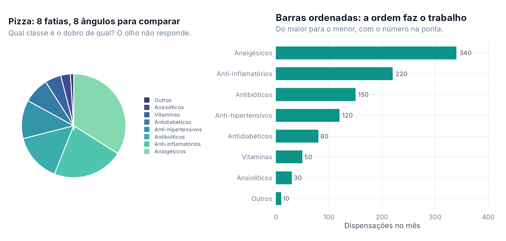{height=360px}

<p class="figcap">Oito classes de dispensação. Na pizza, responder "a primeira é o dobro da segunda?" exige medir ângulos com o olho. Nas barras ordenadas, a resposta está na ordem e no número.</p>

## Empilhadas: três desenhos, três perguntas

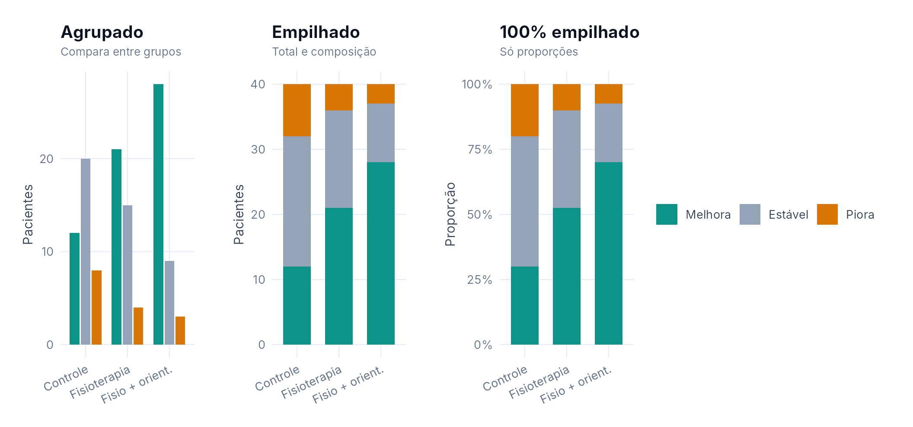{height=360px}

<p class="figcap">Agrupado: "quantos em cada desfecho?" · Empilhado: "qual o total e a composição?" · 100%: "qual a proporção?" — e só este último é honesto para comparar proporções, desde que o n apareça.</p>

## Boxplot anatômico

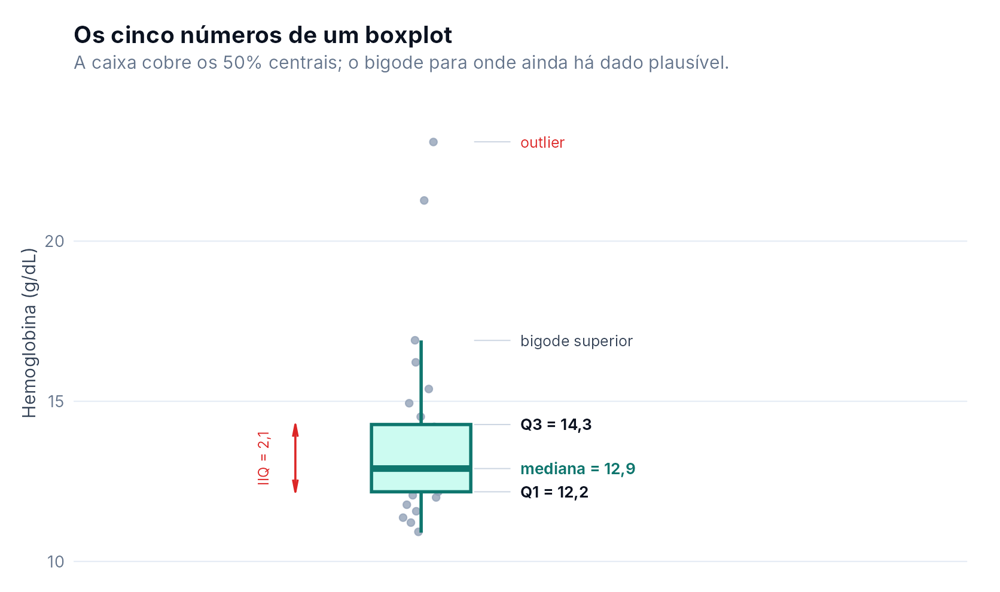{height=380px}

<p class="figcap">Q1 = 12,2 · mediana = 12,9 · Q3 = 14,3 · IIQ = 2,1 · bigode até 16,9 · outliers 21,3 e 23,1. O boxplot é uma cerca desenhada.</p>

## Pares: cada paciente é uma linha

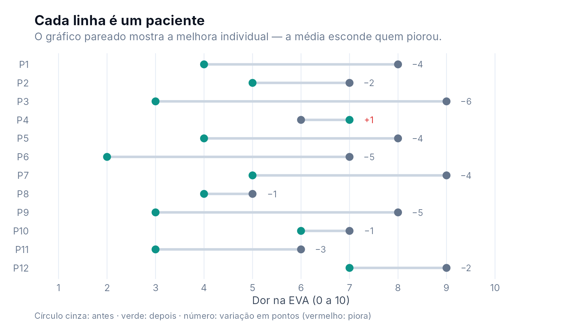{height=380px}

<p class="figcap">Onze de doze melhoraram — e um piorou. "EVA média 7,4 → 4,1" apaga exatamente o paciente que precisa ser discutido.</p>

## Séries temporais: tendência, ciclo e intervenção

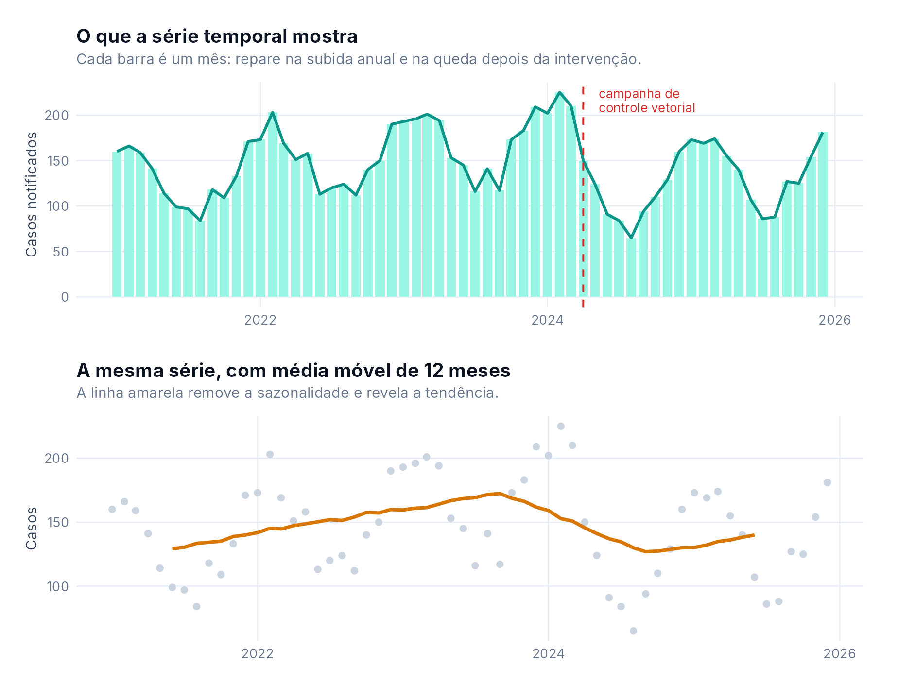{width=660px}

<p class="figcap">Acima: tendência de alta + ciclo anual + queda após a campanha. Abaixo: média móvel de 12 meses, que apaga o ciclo e revela a tendência. Nenhum está errado — respondem a perguntas diferentes.</p>

## Dispersão: a nuvem conta mais que o r

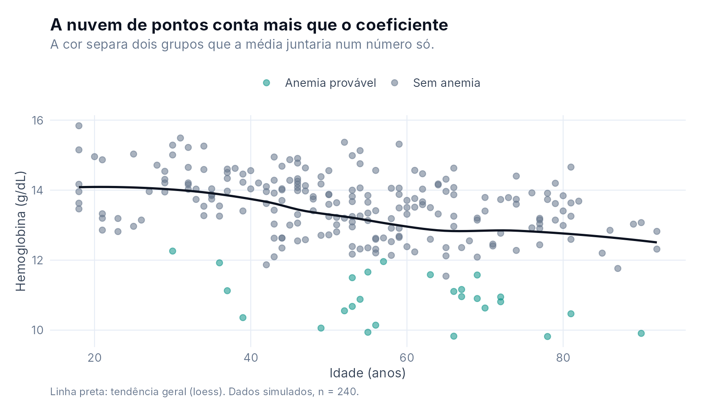{height=310px}

- **Dois perfis na mesma nuvem** — a correlação global esconde a população anêmica.

<p class="figcap">Sobreposição: use `alpha` ou hexbin. E lembre: associação não é causa.</p>

## Mapa de calor: 28 correlações de uma vez

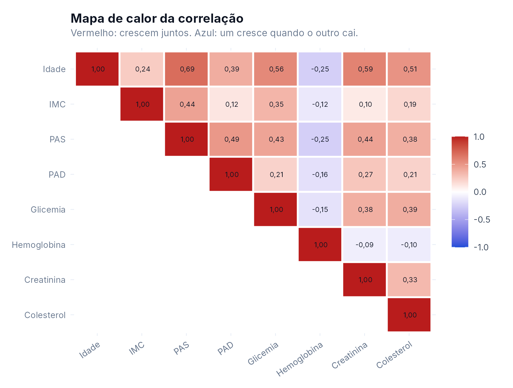{width=640px}

<p class="figcap">Escala divergente centrada em zero, metade simétrica omitida, valor escrito dentro da célula. E ordene as linhas por similaridade: os blocos aparecem.</p>

## Volcano: efeito × evidência

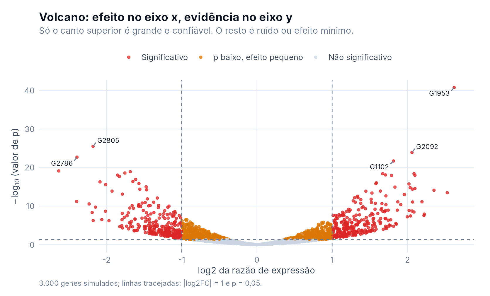{height=380px}

<p class="figcap">Eixo x: tamanho do efeito (log2FC). Eixo y: força da evidência (−log10 p). Os candidatos são os cantos superiores — mas 3.000 testes exigem correção para múltiplas comparações.</p>

## Sobrevida: o tempo até o desfecho

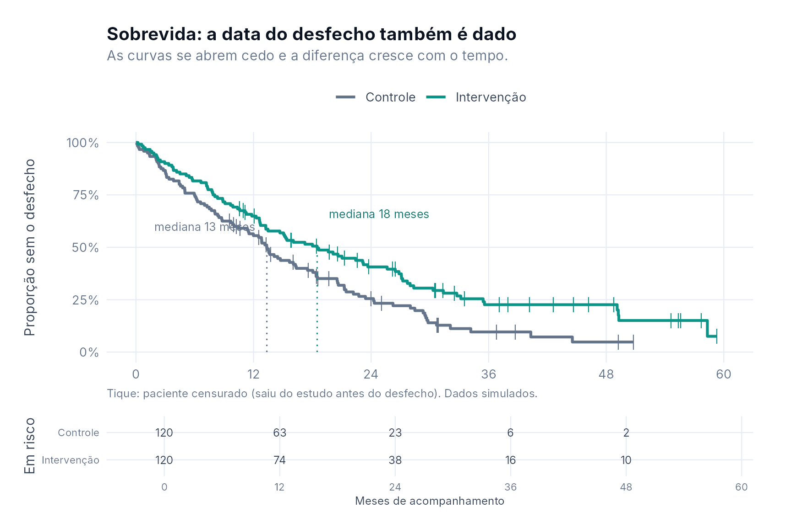{width=640px}

<p class="figcap">Degraus, tiques de censura e tabela de risco: sem ela, 2 pacientes no mês 48 parecem iguais a 120. Medianas: 13 e 18 meses.</p>

## Forest plot: a síntese da evidência

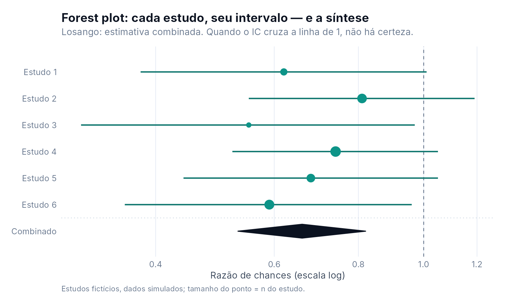{height=380px}

<p class="figcap">Só 2 dos 6 estudos são significativos isoladamente — e o losango combinado (0,66; IC 0,53–0,82) é conclusivo. É o argumento da metanálise e o seu perigo: só vale se os estudos forem comparáveis.</p>

## Treemap: hierarquia que cabe na tela

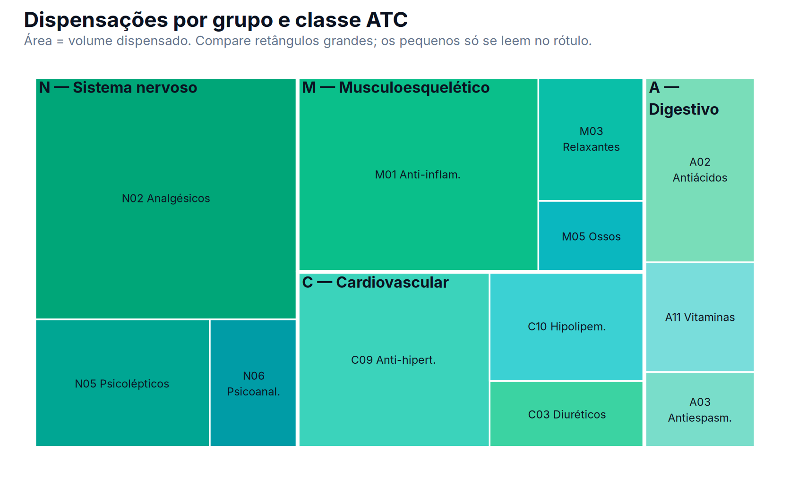{height=380px}

<p class="figcap">Área proporcional, hierarquia grupo → classe (ATC). Ótimo para estrutura, ruim para comparar valores próximos: retângulos finos enganam o olho.</p>

## Nuvem de palavras: convite, não análise

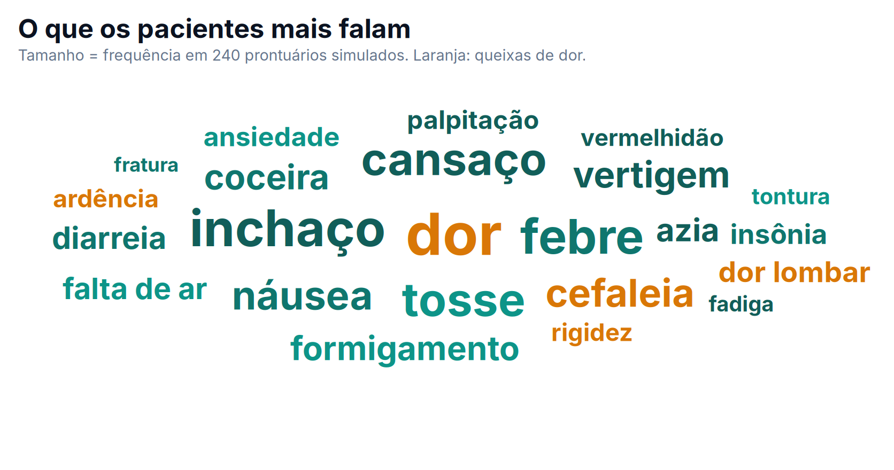{height=360px}

<p class="figcap">Área não é linear (dobro da fonte ≈ quatro vezes a área), a posição é arbitrária e não há escala. Use como abertura — e acompanhe com barras das 10 mais frequentes.</p>

## Árvore de palavras: a frase inteira

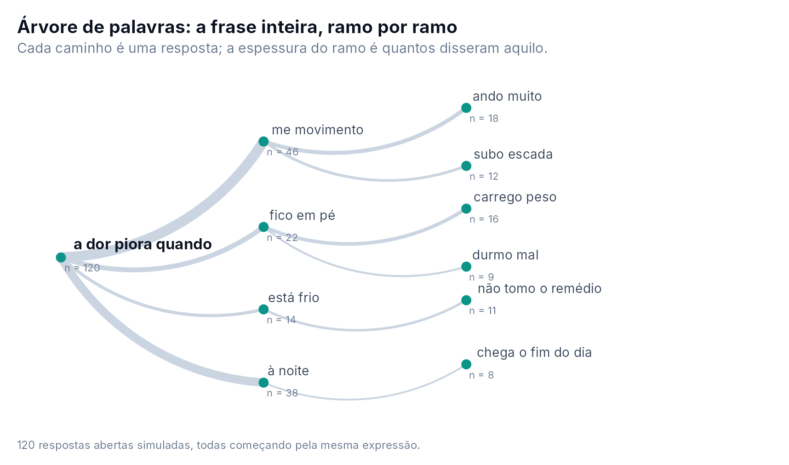{height=380px}

<p class="figcap">"Me movimento" se desdobra em andar, subir escada e carregar peso — três situações que a nuvem trataria como uma só. O custo é a codificação manual.</p>

## Redes: a topologia é o achado

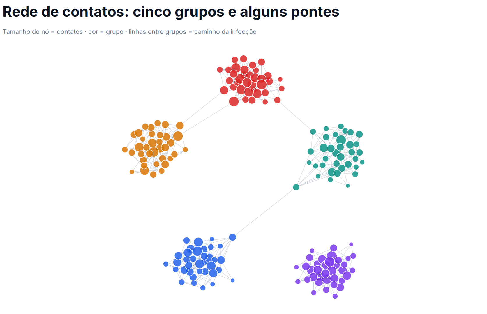{height=390px}

<p class="figcap">Cinco grupos densos e poucas pontes entre eles: são as pontes que decidem se o surto fica contido. Nenhuma coluna de planilha contém essa informação.</p>

## Similaridade: fármacos que se parecem

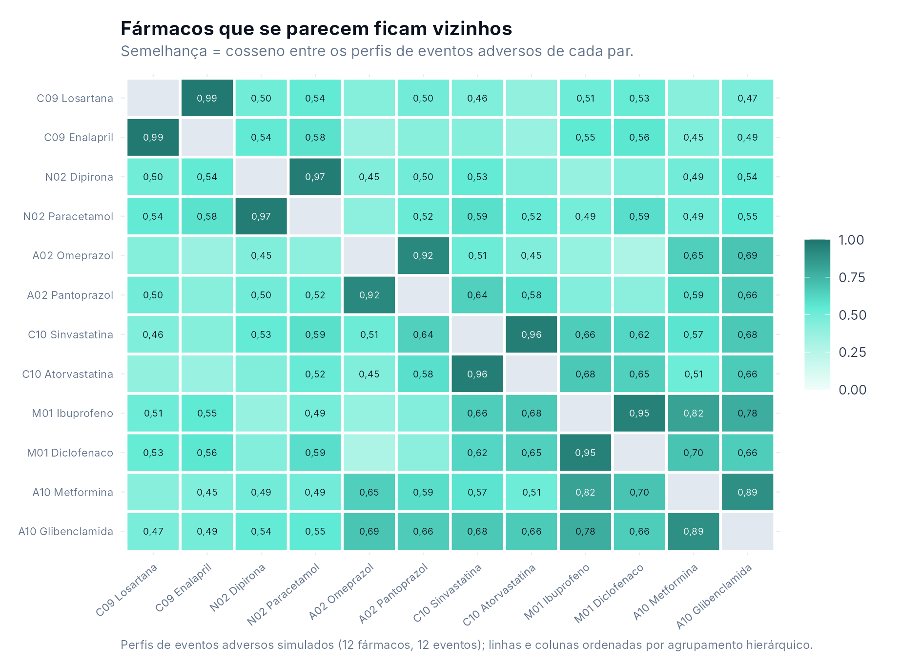{width=620px}

<p class="figcap">Perfis de eventos adversos, similaridade de cosseno, ordenação por agrupamento. Os blocos na diagonal são descobertos nos dados. Similaridade não é equivalência terapêutica.</p>

## O que faz um gráfico moderno funcionar

:::: {.cards .cols-2}
::: {.card}
**Decisões que fazem a figura**

Título com a mensagem · rótulo direto · ordem com sentido · base zero para área · cor com significado · anotação no ponto · incerteza visível · **n** em toda figura.
:::

::: {.card}
**O teste final**

O leitor entende sem ajuda?

Se você precisou explicar o gráfico no texto, **o gráfico ainda não está pronto**.
:::
::::

<p class="figcap">Sofisticação sem pergunta é enfeite. O melhor gráfico é o que o leitor entende sem ajuda — não o que tem mais camadas.</p>

## Tipos modernos que valem conhecer

| Gráfico | Serve para | Cuidado |
|:--|:--|:--|
| **Small multiples** | mesma medida em muitos grupos | escala idêntica entre painéis |
| **Slope / dumbbell** | antes e depois no mesmo indivíduo | destaque os extremos |
| **Raincloud / beeswarm** | distribuição com n pequeno | vira bagunça acima de ~200 pontos |
| **Ridgeline** | muitas distribuições empilhadas | sobreposição esconde valores |
| **Hexbin** | dispersão com milhares de pontos | legenda de cor explícita |
| **Alluvial / Sankey** | fluxo entre estados | vira espaguete; agrupe |
| **Mapa coroplético** | padrão geográfico | normalize por população |

<p class="figcap">Referências para olhar: Our World in Data, Financial Times, The Economist, NYT — todos usam as mesmas dez decisões da tela anterior.</p>

## Como um gráfico engana

::: {.incremental}
- **Eixo truncado** em barras — a diferença parece maior do que é.
- **Escala logarítmica sem aviso** — achata crescimentos enormes.
- **Área ou volume** — o dobro do diâmetro é quatro vezes a área; o leitor lê "duas vezes".
- **Efeito 3D** — desloca a leitura da altura e não informa nada.
- **Eixo duplo** — permite criar qualquer correlação visual.
- **Pizza com 12 fatias** — ângulos pequenos são indistinguíveis.
:::

## Caça ao erro

Três figuras de um artigo. Qual é o problema de **cada uma**?

::: {.incremental}
1. Gráfico de barras comparando dois grupos que diferem 0,3 ponto, com eixo de 8,2 a 9,0.
2. Boxplot por grupo com 3 pacientes em cada, sem os pontos individuais.
3. Pizza com 11 espécies de bactérias isoladas em culturas.
:::

<p class="small">Dois minutos com o colega ao lado. Depois discutimos.</p>

## Caça ao erro — respostas

::: {.incremental}
- **1. Eixo truncado.** Barras que diferem 3% viram barras de alturas muito diferentes. Corrija começando o eixo em zero (ou use pontos).
- **2. n pequeno demais para um resumo.** Com 3 pacientes, o boxplot esconde os valores e sugere precisão que não existe. Mostre os pontos.
- **3. Pizza com fatias demais.** Ângulos pequenos não se comparam. Use barras ordenadas.
:::

## Tabela: encontre os cinco problemas

| Grupo | Idade | Hemoglobina | Anemia |
|:--|:--|:--|:--|
| A | 45,3 | 13,2 ± 1,5 | 32% |
| B | 47 | 12,8 ± 1,4 | 28,4% |

::: {.callout-tip icon="false"}
## Sua vez
São **cinco problemas**. Dois minutos, em duplas: anote cada um e depois compare com a tabela do próximo slide.
:::

<p class="small">Dica: casas decimais, o símbolo "mais ou menos", as porcentagens e o significado de "A" e "B".</p>

## Tabela: a versão que passa no revisor

| Grupo | n | Idade (anos) | Hemoglobina (g/dL) | Anemia, n (%) |
|:--|--:|--:|--:|--:|
| Controle | 60 | 45,3 (12,1) | 13,2 (1,5) | 19 (31,7) |
| Fisioterapia | 58 | 47,0 (11,8) | 12,8 (1,4) | 16 (27,6) |

*Valores são média (DP), exceto n e Anemia, n (%).*

::: {.keybox}
Os cinco problemas eram: **decimais inconsistentes**, **"±" sem legenda**, **% sem denominador**, **nenhum n** e **unidades fora do cabeçalho**.
:::

## As sete regras da tabela

::: {.incremental}
- **Unidade no cabeçalho** — "Hemoglobina (g/dL)", nunca "13,2 g/dL" em cada célula.
- **Mesmas casas decimais** na coluna — 45,3 e 47,0.
- **Todo símbolo tem legenda** — "±" é DP, EPM ou IC?
- **Porcentagem com denominador** — 32% (19/60).
- **n em cada grupo.**
- **Números alinhados à direita**, vírgula sob vírgula.
- **Ordem lógica** — por grupo, por frequência ou cronológica.
:::

## Tabela 1: o resumo que vai para o artigo

Na prática, a descritiva vira uma tabela — e o R faz isso em poucas linhas com o pacote `gtsummary`:

```r
dados |>
  select(idade, tratamento, resposta) |>
  tbl_summary(by = tratamento) |>
  add_p()
```

::: {.keybox}
A **Tabela 1** é o retrato do estudo: quem são os pacientes, como os grupos se comparam e se o sorteio funcionou.

Se os grupos já diferem na Tabela 1, qualquer comparação posterior nasce suspeita.
:::

## Parte 4 — Fechando {.divider}

## Outliers: três origens

:::: {.cards .cols-3}
::: {.card}
**Erro de digitação**

800 em vez de 80; 2,5 g/dL em vez de 12,5. Corrige-se na fonte.
:::

::: {.card}
**Erro de medição**

Aparelho descalibrado, amostra hemolisada, paciente sem jejum. Registre e discuta.
:::

::: {.card}
**Evento real**

O paciente com glicemia de 420 mg/dL existe — e é justamente o caso que interessa.
:::
::::

## O que fazer com o outlier

::: {.incremental}
- **Verifique na fonte** — prontuário, ficha, laudo — antes de qualquer decisão.
- **Nunca apague em silêncio.** "Limpei os outliers" transforma resultado verdadeiro em resultado bonito.
- **Análise de sensibilidade** — repita com e sem o valor e relate as duas.
- **Se é real, é dado** — relate a mediana e discuta o caso.
:::

<p class="small">O critério de 1,5 × IIQ diz "olhe com atenção", não "descarte".</p>

## Pause e pense

::: {.keybox}
**1.** Um colega relata "tempo médio de internação de 6 dias". Que informação essencial está faltando?

**2.** Na glicemia com o valor 800, você reporta a média ou a mediana? E o que faz com o 800?

**3.** Seu gráfico de barras mostra 62% num grupo e 58% no outro, com eixo de 55% a 65%. O que o leitor vai concluir?
:::

## Respostas

::: {.incremental}
- **1. A dispersão.** "6 dias" pode significar "todo mundo ficou entre 5 e 7" ou "metade ficou 1 dia e metade ficou 11". Sem DP ou IIQ, o número não informa.
- **2. A mediana** — e investigue o 800 antes de qualquer coisa: erro de digitação se corrige na fonte; paciente real merece uma nota no relatório.
- **3. Que a diferença é enorme.** Com o eixo em zero, 62% e 58% são barras quase iguais — e é essa a leitura honesta.
:::

## Mão na massa: caça ao erro no R

```{webr-r}
# pressao de 9 pacientes, em mmHg
pressao <- c(120, 125, 118, 122, 130, 128, 119, 125, 1200)

summary(pressao)
round(c(media = mean(pressao),
        mediana = median(pressao)), 1)
boxplot(pressao, col = "#d97706")
```

<p class="small">Ache o valor impossível, corrija na fonte e rode de novo. Depois escreva a frase que você colocaria no artigo.</p>

## O que levar daqui

::: {.incremental}
- **Explore antes de testar** — o teste aplicado sobre dado sujo produz erro com aparência de rigor.
- **Centro e dispersão andam juntos** — média sem desvio padrão é meia informação.
- **A forma decide a medida** — simétrica: média e DP; assimétrica ou ordinal: mediana e IIQ.
- **DP descreve pacientes; EPM descreve a estimativa** — confundir os dois é o erro mais comum.
- **O gráfico certo depende do tipo do dado** — e o eixo das barras começa em zero.
- **Outlier é uma pergunta, não um incômodo** — erro ou descoberta, decida com critério.
:::

## Próximos passos

Com os dados descritos, começa a parte que separa a descrição da decisão: **quantificar a incerteza**. É o caminho da probabilidade ao teste de hipóteses.

::: {.callout-note icon="false"}
## 📚 Material de apoio
Para revisar a teoria e resolver as questões de fixação, acesse o capítulo no livro interativo.

[Ir para o Livro Interativo: Capítulo 4](../../cap04_aed.html){target="_blank"}
:::

<p class="small">Dúvidas: marcio.souza@ufjf.br · souza.mlm@gmail.com<br>
DOI: <a href="https://doi.org/10.5281/zenodo.23858966" target="_blank">10.5281/zenodo.23858966</a></p>
